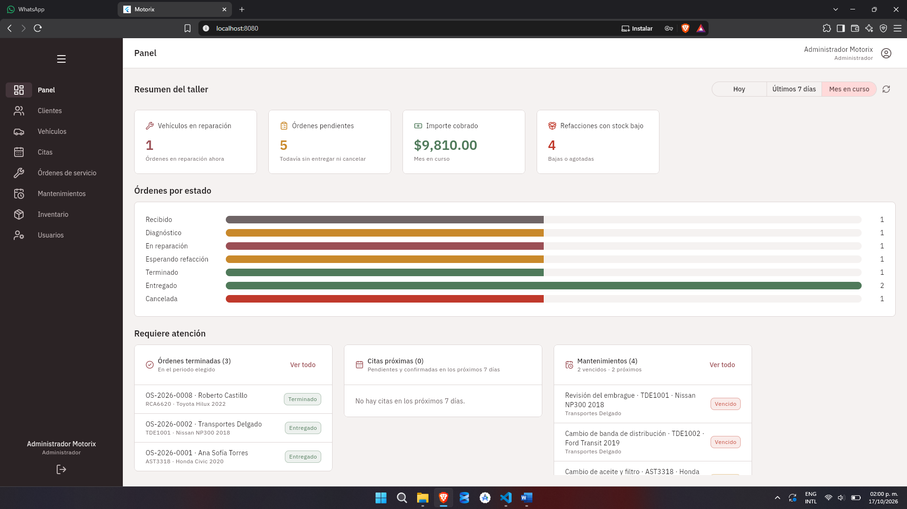
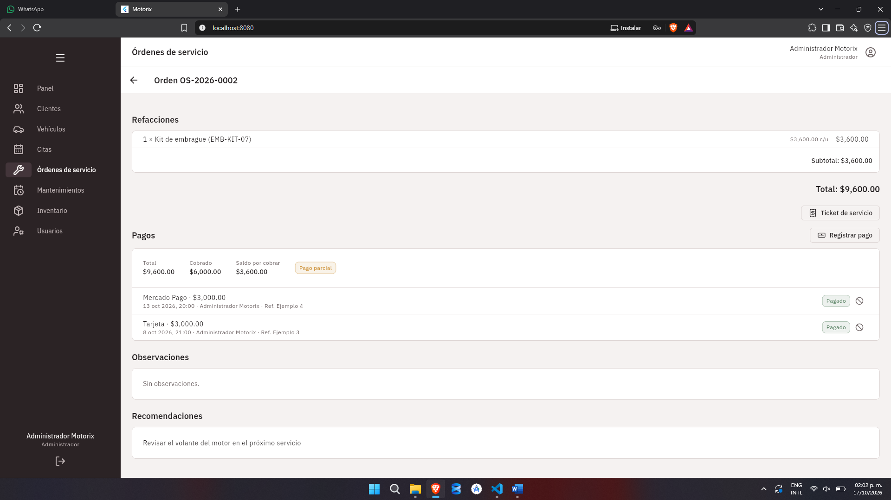
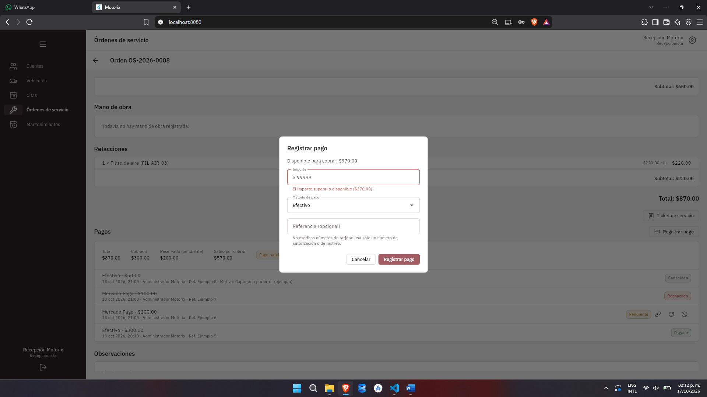
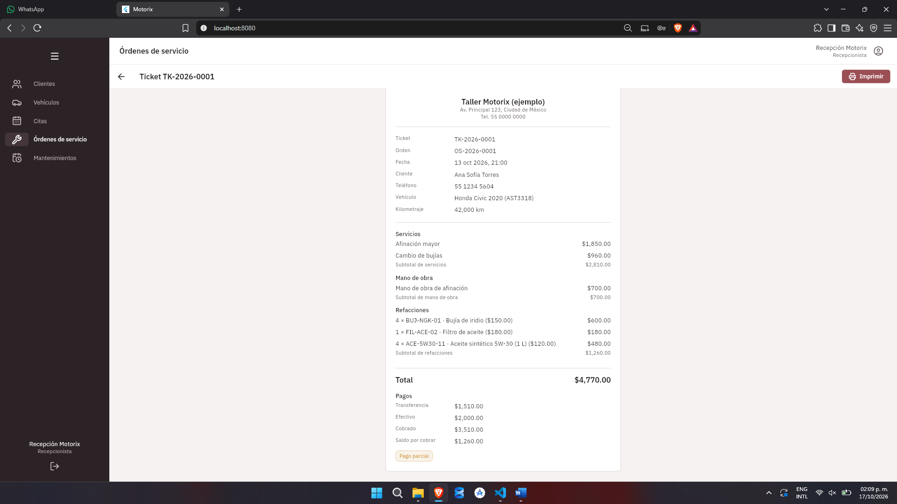
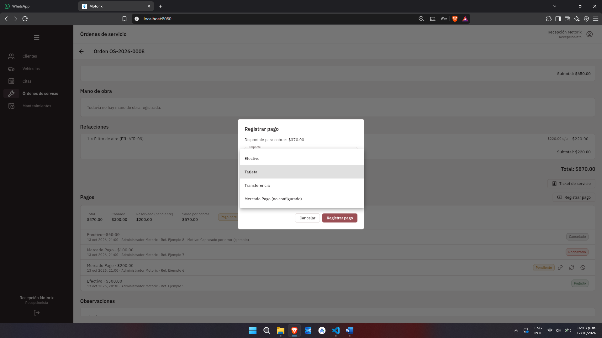
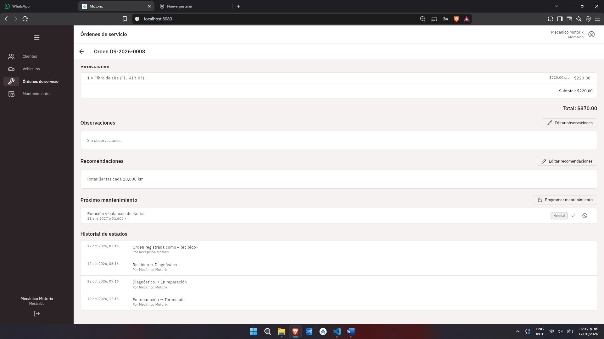

# Reporte individual: SDD con Spec Kit

**Proyecto:** Motorix, sistema de gestión para un taller mecánico
**Funcionalidad que se reporta:** Sprint 4, pagos, tickets y panel de control (`specs/004-pagos-tickets-dashboard/`)

## Datos de la entrega

| Campo | Mi respuesta |
|---|---|
| Alumno | Edward Negrete Bustos |
| Equipo y proyecto | Equipo Motorix, Sistema de Gestión para Taller Mecánico. Integrantes: Carlos Castro Rafael, Jorge Francisco Domínguez Ramírez, Raúl Francisco Amador, Joaquín Ignacio Trejo, José Adrián Mendoza Hernández y Edward Negrete Bustos |
| Mi rol | Product Builder |
| Enlace al repositorio | https://github.com/Edward2418/Motorix |
| Rama con todo el proceso | [`004-pagos-tickets-dashboard`](https://github.com/Edward2418/Motorix/tree/004-pagos-tickets-dashboard) |
| Agente o herramienta de IA | Claude Code (modelo Claude Sonnet 5.5) con Spec Kit |

Sobre la rama: la rama `004-pagos-tickets-dashboard` nació de las anteriores, así que contiene todo el historial en línea recta: la constitution, los sprints 1 a 3 y el Sprint 4 completo. No hay merges, squash ni force-push; cuando algo se corrigió, se hizo con un commit nuevo. Para este reporte tomé el Sprint 4 porque es donde el historial muestra el proceso completo y en orden: spec, clarificación, plan, tareas e implementación, cada uno en commits separados.

---

## Apartado 0. Índice de evidencias

Los enlaces con hash apuntan a la versión exacta del archivo en ese commit.

| Apartado | Evidencia | Commit |
|---|---|---|
| 1. Contexto y constitution | [`.specify/memory/constitution.md`](https://github.com/Edward2418/Motorix/blob/e406163/.specify/memory/constitution.md) | `e406163` |
| 2. Spec (versión inicial) | [`specs/004-…/spec.md`](https://github.com/Edward2418/Motorix/blob/bd9e47d/specs/004-pagos-tickets-dashboard/spec.md) | `bd9e47d` |
| 2. Spec (tras clarificar) | [`specs/004-…/spec.md`](https://github.com/Edward2418/Motorix/blob/9a2dff5/specs/004-pagos-tickets-dashboard/spec.md) | `9a2dff5` |
| 2. Spec (con criterios EARS) | [`specs/004-…/spec.md`](https://github.com/Edward2418/Motorix/blob/01ec6a7/specs/004-pagos-tickets-dashboard/spec.md) | `01ec6a7` |
| 3. Plan técnico | [`plan.md`](https://github.com/Edward2418/Motorix/blob/40d1d29/specs/004-pagos-tickets-dashboard/plan.md) y [`research.md`](https://github.com/Edward2418/Motorix/blob/40d1d29/specs/004-pagos-tickets-dashboard/research.md) | `40d1d29` |
| 4. Base de datos | [`data-model.md`](https://github.com/Edward2418/Motorix/blob/1f0e8b9/specs/004-pagos-tickets-dashboard/data-model.md) | `40d1d29` y `1f0e8b9` |
| 4. Migración real | [`database/migrations/005_sprint4_payments_tickets.sql`](https://github.com/Edward2418/Motorix/blob/f9a00d0/database/migrations/005_sprint4_payments_tickets.sql) | `f9a00d0` |
| 5. Tareas | [`tasks.md`](https://github.com/Edward2418/Motorix/blob/fe4db1e/specs/004-pagos-tickets-dashboard/tasks.md) | `ad09e2d` y `fe4db1e` |
| 5 y 6. Análisis, trazabilidad y pruebas | [`trazabilidad.md`](https://github.com/Edward2418/Motorix/blob/c39653b/specs/004-pagos-tickets-dashboard/trazabilidad.md) | `e432ea1` y `c39653b` |
| 6. Implementación | Historial de commits desde `f9a00d0` hasta `fe4db1e` | ver apartado 6 |
| 6. Capturas y salida de pruebas | [`docs/evidencias/`](https://github.com/Edward2418/Motorix/tree/004-pagos-tickets-dashboard/docs/evidencias) | [`6a48d85`](https://github.com/Edward2418/Motorix/commit/6a48d85) |
| 7. EARS | Sección «Criterios de aceptación en EARS» del spec | `01ec6a7` |

---

## Apartado 1. Contexto y constitution

Qué problema resuelve Motorix. Muchos talleres mecánicos no tienen un sistema que concentre la información de clientes, vehículos, servicios e inventario, y eso dificulta controlar las actividades y dar seguimiento a los mantenimientos (así lo plantea `docs/project-context.md`). Motorix organiza esas operaciones: servicios, refacciones, pagos, historial de cada vehículo y atención a clientes. Lo usan tres perfiles: administración (el dueño o encargado), recepción y mecánicos. El MVP se hizo en cuatro sprints: (1) base, clientes y vehículos; (2) citas y órdenes de servicio; (3) historial, mantenimiento e inventario; y (4) pagos, tickets y panel de control.

La constitution. Es el archivo de Spec Kit con las reglas que no se negocian durante todo el proyecto. Estos son los principios que más me sirvieron y por qué los elegimos:

| Principio | Qué dice | Por qué lo elegimos |
|---|---|---|
| Alcance y MVP (I) | Se sigue el orden de sprints y no se agrega nada fuera del alcance sin aprobación; WhatsApp queda fuera | Se busca un MVP que funcione de punta a punta antes de sumar funciones |
| Arquitectura por capas (II) | Cliente, servidor, base de datos e integraciones separados; la lógica de negocio vive en `services/` y Mercado Pago queda aislado | Cada capa se puede probar y cambiar sin romper las demás; el aislamiento permitió probar pagos sin conectarse a Mercado Pago |
| Stack acotado (III) | Flutter, Node.js con Express (solo ES Modules), MySQL local con scripts SQL versionados, JWT y bcrypt | Son tecnologías que el equipo ya conoce; los scripts numerados permiten recrear la base desde cero |
| Seguridad (IV) | Contraseñas con hash, secretos en variables de entorno, permisos validados en el servidor, nada de datos de tarjeta | El sistema maneja datos de clientes y pagos; un fallo de seguridad invalida el proyecto |
| Reglas de negocio (V) | Todo pago pertenece a una orden, una orden entregada no se borra, no hay stock negativo | Protegen la consistencia del inventario, el historial y los cobros |
| Pruebas (VII) | Jest y supertest contra una base `motorix_test`, y pruebas propias de Flutter | Las reglas de estados e inventario fallan en silencio si no hay pruebas; la base separada evita borrar datos reales |
| Interfaz sencilla (VIII) | Seguir el sistema de diseño, con confirmación en acciones destructivas | El personal del taller no es técnico; una pantalla clara importa más que una vistosa |

Evidencia: [`.specify/memory/constitution.md`](https://github.com/Edward2418/Motorix/blob/e406163/.specify/memory/constitution.md), creada en el commit `e406163`.

---

## Apartado 2. Spec

El spec del Sprint 4 define qué se construye y por qué, sin hablar de tecnología. Tiene 6 historias de usuario, 37 requisitos funcionales (FR-001 a FR-037), 11 criterios de éxito medibles (SC-001 a SC-011) y una lista de casos límite. Cada historia incluye una prueba independiente y escenarios en formato Dado/Cuando/Entonces.

| Historia | Para quién | Qué permite |
|---|---|---|
| US1 | Recepción | Registrar el pago de una orden, parcial o total |
| US2 | Recepción | Elegir el método de pago |
| US3 | Recepción | Cobrar con Mercado Pago |
| US4 | Recepción | Generar el ticket de servicio |
| US5 | Administración | Ver indicadores en el panel de control |
| US6 | Administración | Ver órdenes, citas, mantenimientos y alertas que requieren atención |

### Ambigüedades que resolví con `/speckit-clarify`

El comando me hizo 5 preguntas y las respondí todas. El spec cambió entre el commit `bd9e47d` (versión inicial) y el `9a2dff5` (clarificado). [Aquí se ve la comparación completa.](https://github.com/Edward2418/Motorix/compare/bd9e47d...9a2dff5)

| # | Pregunta | Mi respuesta | Qué cambió en el spec |
|---|---|---|---|
| 1 | ¿Cómo se entera Motorix del resultado de un pago de Mercado Pago? | Solo por consulta, con el botón «Actualizar estado»; sin avisos automáticos | Se quitó el supuesto de recibir notificaciones del servicio externo; la historia 3 se reescribió |
| 2 | ¿El ticket se guarda como PDF? | No: solo se ve en pantalla y se imprime | El PDF pasó a «fuera del alcance» |
| 3 | ¿Cuáles son los cuatro indicadores del panel? | Vehículos en reparación, órdenes pendientes, importe cobrado y stock bajo | Quedaron definidos en la historia 5 |
| 4 | ¿Un pago de Mercado Pago pendiente reserva su importe? | Sí; lo disponible es total menos cobrado menos reservado | Cambió el escenario 3 de la historia 1 (de «saldo» a «importe disponible») |
| 5 | ¿El ticket muestra datos vigentes o una copia? | Siempre vigentes, con aviso si la orden cambió | Se agregó el escenario del aviso de orden modificada |

### Criterios en EARS

Después reescribí los requisitos principales en formato EARS (13 criterios, cada uno con su FR o SC y un dato comprobable). Está en el apartado 7.

Evidencia: [`spec.md`](https://github.com/Edward2418/Motorix/blob/01ec6a7/specs/004-pagos-tickets-dashboard/spec.md) y los commits `bd9e47d`, `9a2dff5` y `01ec6a7`.

---

## Apartado 3. Plan técnico

El plan (`plan.md`) y la investigación (`research.md`) dicen cómo se construye. Es coherente con la constitution: el plan tiene una tabla que revisa los 8 principios y los 8 pasan.

Arquitectura y stack (sin cambios respecto a los sprints anteriores): app Flutter (web y Windows) con Provider, API REST en Node.js con Express y `mysql2`, MySQL local. El Sprint 4 agrega tres tablas, tres módulos de API (pagos, tickets y panel) y cuatro pantallas o diálogos. El servidor no suma dependencias y el cliente suma solo dos (`pdf` y `printing`).

### Decisiones y alternativas que descarté

| Decisión | Alternativas descartadas | Por qué | Principio |
|---|---|---|---|
| Mercado Pago con `fetch` de Node (Checkout Pro, modo de pruebas), aislado en `services/gateways/` | SDK oficial; webhook; Checkout API con tarjeta en nuestra app | El SDK sería una dependencia nueva para dos llamadas HTTP; el webhook exige una dirección pública (y lo descartó la clarificación 1); procesar tarjetas en la app rompe la regla de no guardar datos de tarjeta | II y IV |
| El estado del pago se actualiza por consulta («Actualizar estado»), de forma idempotente | Recibir avisos automáticos | Es lo que se decidió en la clarificación; evita exponer el servidor | IV |
| Imprimir el ticket con `pdf` y `printing`, en memoria | Página HTML del servidor; `window.print()` solo web; PDF generado en el servidor | Funciona en Windows y en web, sin guardar archivos en el servidor | VIII y dependencias justificadas |
| El ticket se arma al consultarlo; solo guarda el folio y el total como firma | Guardar una copia del contenido | Una copia se desactualiza y duplica datos; el aviso de «orden modificada» cubre el cambio | V |
| Reglas de importes en una función pura (`paymentRules`) y pagos en una transacción que bloquea la orden (`FOR UPDATE`) | Sin alternativa registrada en `research.md`; se reutilizó el bloqueo que ya usaban los cambios de estado y de refacciones | Dos pagos simultáneos no pueden pasar del total; una función pura se prueba sin base de datos | V y VII |
| Cifras del panel calculadas con consultas de lectura sobre las tablas reales | Tablas de resumen o vistas materializadas | Las copias pueden divergir de los datos reales | V |

Evidencia: [`plan.md`](https://github.com/Edward2418/Motorix/blob/40d1d29/specs/004-pagos-tickets-dashboard/plan.md) y [`research.md`](https://github.com/Edward2418/Motorix/blob/40d1d29/specs/004-pagos-tickets-dashboard/research.md), commit `40d1d29`.

---

## Apartado 4. Base de datos

El Sprint 4 agrega 3 tablas en la migración `005_sprint4_payments_tickets.sql`, sin tocar las migraciones anteriores. MySQL con InnoDB y `utf8mb4`.

```text
service_orders 1 ── N payments         (payments.order_id)
service_orders 1 ── 0..1 tickets       (tickets.order_id, único)
users 1 ── N payments / tickets        (created_by, cancelled_by, generated_by)
ticket_folio_counters (year) ──> genera tickets.folio
```

| Entidad | Campos clave | Restricciones | Requisito que responde |
|---|---|---|---|
| `payments` | `order_id`, `amount`, `method`, `status`, `reference`, datos de Mercado Pago, `cancel_reason`, `created_by` | FK con `ON DELETE RESTRICT`; `CHECK amount > 0`; `CHECK` de motivo al cancelar; `UNIQUE` en la referencia externa | FR-001 a FR-007, FR-011 a FR-016 (US1, US2, US3) |
| `tickets` | `folio`, `order_id`, `order_total`, `generated_by`, `generated_at` | `UNIQUE` en `folio` y en `order_id`; FK con `RESTRICT` | FR-019 a FR-024 (US4) |
| `ticket_folio_counters` | `year`, `last_number` | PK por año; incremento atómico | FR-019, FR-034 |

El resumen de pagos de cada orden y los indicadores del panel no tienen tabla: se calculan al consultar, porque FR-021 y FR-027 prohíben duplicar datos. En `data-model.md` está la tabla completa que liga cada columna con su requisito y dice si lo impone la base de datos o el servicio.

Evidencia: [`data-model.md`](https://github.com/Edward2418/Motorix/blob/1f0e8b9/specs/004-pagos-tickets-dashboard/data-model.md) (commits `40d1d29` y `1f0e8b9`) y la [migración real](https://github.com/Edward2418/Motorix/blob/f9a00d0/database/migrations/005_sprint4_payments_tickets.sql) (commit `f9a00d0`). Los datos de ejemplo están en `database/seeds/008_sample_payments.sql` y `009_sample_tickets.sql`, y son repetibles sin duplicar registros.

---

## Apartado 5. Tareas

`tasks.md` divide el plan en 85 tareas pequeñas, ordenadas en 9 fases: preparación, fundamentos (lo que bloquea todo lo demás), una fase por historia de usuario (US1, US2, US4, US3, US5 y US6) y pulido final. Cada tarea trae su ID, la historia a la que pertenece (`[US#]`), la ruta exacta del archivo y, si se puede hacer en paralelo, la marca `[P]` (43 de ellas). Primero van las pruebas de cada historia, que deben fallar antes de implementar. El archivo también tiene una sección de dependencias entre fases e historias, y fui marcando las tareas conforme las terminaba.

### Qué encontró el análisis de consistencia

Corrí `/speckit-analyze` antes de implementar. Salió sin problemas críticos ni altos y con 11 hallazgos (6 medios y 5 bajos). Cobertura del 100 % de los requisitos con al menos una tarea. Algunos ejemplos:

- **D1 (medio):** una tarea de los fundamentos dependía de otra de una fase posterior (la pasarela falsa para pruebas).
- **D2 (medio):** no estaba claro cómo crear el pago en Mercado Pago ni cuándo usar el enlace de pruebas; se resolvió con una variable `MERCADOPAGO_SANDBOX`.
- **D4 (medio):** el panel y el saldo podían calcular un total distinto al de la orden; se resolvió exportando el cálculo como un fragmento SQL compartido.
- **D6 (medio):** faltaba probar pagos y tickets de clientes desactivados; no lo resolví durante el sprint, lo agregué al final (commit `c39653b`).

No apliqué las ediciones antes de implementar; fui resolviendo los hallazgos sobre la marcha. En [`trazabilidad.md`](https://github.com/Edward2418/Motorix/blob/c39653b/specs/004-pagos-tickets-dashboard/trazabilidad.md) están los 11 con su resolución y su evidencia.

Evidencia: [`tasks.md`](https://github.com/Edward2418/Motorix/blob/fe4db1e/specs/004-pagos-tickets-dashboard/tasks.md), con las 85 tareas marcadas.

---

## Apartado 6. Implementación y verificación

### De las tareas a los commits

Hice un commit por fase o historia, no uno por tarea, así que cada commit agrupa varias. La tabla sale de las casillas que cambió cada commit en `tasks.md`:

| Commit | Historia o fase | Tareas | Qué implementa |
|---|---|---|---|
| `f9a00d0` | Preparación y fundamentos | T001 a T012 | Migración, reglas de importes, errores, modelos base y ayudantes de pruebas |
| `bec207b` | US1, servidor | T013 a T025 | Registrar y cancelar pagos de una orden |
| `906d5e6` | US1, interfaz | T026 a T029 | Sección de pagos y diálogo de pago |
| `f14cbd8` | US2 | T030 a T034 | Métodos de pago y validación de la referencia |
| `a01aedd` | US4, servidor | T035 a T042 | Folio atómico y ticket |
| `0eab4ab` | US4, interfaz | T043 a T045 | Pantalla del ticket e impresión |
| `3fe5440` | US3, servidor | T046 a T056 | Mercado Pago en modo de pruebas |
| `399a1bd` | US3, interfaz | T057 a T059 | Enlace de pago y «Actualizar estado» |
| `f9a7002` | US5 y US6, servidor | T060 a T066, T071 a T073 | Indicadores y listas de atención |
| `5a1b9b4` | US5 y US6, interfaz | T067 a T070, T074, T075 | Pantalla del panel |
| `f523b7e` | Pulido | T076 a T084 | Datos de ejemplo, documentación y rendimiento |
| `fe4db1e` | Cierre | T085 | Verificación final |

### Verificación contra los criterios del spec

Cada criterio EARS se comprueba con pruebas automatizadas. Resultado de la corrida completa: 762 pruebas en el servidor (82 archivos) y 208 en el cliente, todas pasando (corrida del 17 de octubre de 2026). La salida está en [`docs/evidencias/pruebas-servidor.txt`](https://github.com/Edward2418/Motorix/blob/004-pagos-tickets-dashboard/docs/evidencias/pruebas-servidor.txt) y [`pruebas-cliente.txt`](https://github.com/Edward2418/Motorix/blob/004-pagos-tickets-dashboard/docs/evidencias/pruebas-cliente.txt).

| Criterio | Cumple | Prueba principal |
|---|---|---|
| EARS-01 Importe mayor al disponible | Sí | `payments-register.test.js` |
| EARS-02 Pagos simultáneos | Sí | `payments-concurrency.test.js` |
| EARS-03 Cancelar un pago cobrado | Sí | `payments-cancel.test.js` |
| EARS-04 Actualizar pago de Mercado Pago | Sí, con pasarela simulada | `payments-mercadopago.test.js` |
| EARS-05 Ticket repetido, mismo folio | Sí | `tickets.test.js`, `tickets-concurrency.test.js` |
| EARS-06 Periodo del panel | Sí | `dashboard-indicators.test.js` |
| EARS-07 Orden abierta o cancelada | Sí | `payments-register.test.js` |
| EARS-08 Mecánico sin permiso | Sí | `payments-permissions.test.js` |
| EARS-09 Referencia con forma de tarjeta | Sí | `paymentReference.test.js` |
| EARS-10 Mercado Pago no responde | Sí, con pasarela simulada | `payments-mercadopago.test.js` |
| EARS-11 Sin credenciales | Sí | `payments-mercadopago.contract.test.js` |
| EARS-12 Nada se elimina | Sí | `no-delete.test.js` |
| EARS-13 Panel en menos de 3 s | Parcial | Medición de 140 a 220 ms (ver más abajo) |

### Demostración con capturas

| Criterio | Captura |
|---|---|
| Panel con 4 indicadores y gráfica (US5) |  |
| Orden con pagos, cobrado y saldo (US1) |  |
| Importe mayor al disponible rechazado (EARS-01) |  |
| Ticket de servicio (US4, EARS-05) |  |
| Mercado Pago sin configurar (EARS-11) |  |
| Mecánico sin pagos, ticket ni panel (EARS-08) |  |

### Lo que todavía no cumple

- Mercado Pago real: solo lo probé con una pasarela simulada. No tuve credenciales de prueba de un vendedor, así que nunca se cobró contra el servicio real.
- Pruebas con personas: no medí tiempos de captura ni usabilidad (SC-001, SC-004 y SC-009).
- Impresión real: el ticket se imprime con una impresora simulada en las pruebas; no lo imprimí en papel.
- Rendimiento: medí el panel con 2,000 órdenes y 5,000 movimientos (140 a 220 ms, siempre menos de 3 s), pero con un script temporal que no quedó en el repositorio.
- Commits por tarea: el historial agrupa varias tareas por commit, como se ve en la tabla.
- Revisión visual: probé la aplicación en un solo navegador y no hice una revisión en otros tamaños de pantalla.

---

## Apartado 7. EARS y reflexión

### (a) Qué es EARS

EARS (Easy Approach to Requirements Syntax) es una plantilla para escribir cada requisito en una sola oración con estructura fija. Obliga a decir cuándo pasa algo y qué hace el sistema, así que una frase como «debe ser rápido» ya no pasa: hay que escribir «en menos de 3 segundos». Tiene cinco formas: sin condición («El sistema debe…»), por evento («Cuando…»), por estado («Mientras…»), por falla («Si…, entonces…») y opcional («Donde…»). Yo lo usé para que cada requisito se pudiera convertir en una prueba.

### (b) Dos requisitos reescritos en EARS

Requisito 1: importe mayor al disponible (FR-004)

- **Antes** (escenario 3 de la historia 1): «**Dado** una orden con saldo disponible de $600 (total menos lo cobrado y lo reservado por pagos pendientes), **Cuando** se intenta registrar un pago de $700, **Entonces** el sistema lo rechaza indicando el importe disponible».
- **Después** (EARS-01): «**Cuando** la recepcionista registre un pago con un importe mayor al disponible de la orden (total menos cobrado menos reservado), el sistema debe rechazarlo e indicar el importe disponible. Ejemplo: en una orden de $1,000 con $400 cobrados, un pago de $700 se rechaza y el mensaje informa $600».

Requisito 2: ticket repetido (FR-020)

- **Antes** (escenario 5 de la historia 4): «**Dado** una orden que ya tiene ticket, **Cuando** se vuelve a generar, **Entonces** no se crea un folio nuevo: se muestra el existente».
- **Después** (EARS-05): «**Cuando** se genere el ticket de una orden que ya tiene uno, el sistema debe devolver el mismo folio (formato TK-AAAA-NNNN) y no crear un segundo».

En el primero, la versión EARS nombra a quién registra el pago y da un ejemplo completo con total, cobrado y rechazado. En el segundo, agrega el formato del folio, que antes no aparecía.

### (c) Dónde lo aplicaré en el siguiente avance

En el Sprint 5, «Precios y cobro» (MOT-47 y MOT-48 en Jira), desde el `/speckit-specify`, antes del plan y de las tareas. En el Sprint 4 los agregué al final, cuando el código ya estaba hecho; esta vez quiero que los criterios guíen las pruebas desde el inicio. Antes de especificar voy a revisar qué falta de verdad, porque el catálogo ya tiene categoría, marca y precios, y el total de la orden ya suma las refacciones. Lo haré en las próximas sesiones y en mi tiempo libre, después de cumplir con los pendientes de otras materias.

### (d) Reflexión

Qué cambié de mi spec. La primera versión usaba «saldo» sin decir qué pasaba con un pago de Mercado Pago pendiente, y asumía que el servicio le avisaría al sistema. Lo corregí en la clarificación: un pago pendiente reserva su importe (disponible = total − cobrado − reservado) y el estado se actualiza con el botón «Actualizar estado». Los criterios EARS los agregué después, porque la primera versión no los tenía.

Qué me dejó trabajar con IA. Tener spec, plan y tareas antes del código me dio una referencia para revisar lo que la IA hacía. El análisis de consistencia, por ejemplo, encontró antes de implementar una tarea que dependía de otra posterior (D1). Lo que me faltó fue cuestionar más. Leía las recomendaciones de la IA y, después de analizarlas un momento, casi siempre aceptaba la opción recomendada. Así se me pasaron cosas sin comprobar, como Mercado Pago real, que solo probé con una pasarela simulada. En el siguiente sprint quiero dedicarle más tiempo a comparar las opciones antes de elegir.

### Bono: EARS en el spec real

Los criterios EARS están en el spec real del Sprint 4, en la sección «Criterios de aceptación en EARS» (13 criterios), agregados en el commit [`01ec6a7`](https://github.com/Edward2418/Motorix/commit/01ec6a7).
