# Aseguramiento de la calidad - Sprint 5: Precios de refacciones y cobro completo

Proyecto: Motorix. Sprint: 5. Rama: `005-precios-refacciones-cobro`. Responsable: Edward Negrete Bustos. Fecha: 2026-11-03.

Este documento es el registro de calidad del Sprint 5 de Motorix. Reúne las puertas de calidad, las decisiones, los riesgos, la trazabilidad de los criterios de aceptación, los hallazgos, la regresión de los sprints anteriores y el control de calidad final, con sus evidencias.

Resultado general: el sprint se aprobó con observaciones el 2026-11-03.

## 0. Datos del documento

| Campo | Valor |
|---|---|
| Sprint | 5 - Precios de refacciones y cobro completo |
| Insumo | `docs/sprints/sprint-5-precios-refacciones-cobro.md` |
| Rama | `005-precios-refacciones-cobro` |
| Responsable | Edward Negrete Bustos, integrante del equipo |
| Fecha de inicio | 2026-11-03 |
| Fecha de cierre | 2026-11-03 |
| Estado general | Aprobado con observación |

## 1. Objetivo y alcance

**Objetivo.** Asegurar que el Sprint 5 salga con calidad: que los requisitos estén completos, sean medibles y no se contradigan, que las pruebas estén planeadas antes del código y que el cambio no rompa lo construido en los sprints 1 a 4.

**Dentro del alcance:** categoría, marca y precios de compra y de venta de las refacciones; total de la orden con refacciones; pago y ticket con el nuevo total; conservación de los pagos y tickets ya emitidos; visibilidad del precio de compra por rol.

**Fuera del alcance:** lo que el insumo del sprint lista en su sección 8 (costeo y reportes financieros, impuestos, descuentos y pagos a plazos, reembolsos, proveedores, notificaciones, reportes, WhatsApp y puesta en producción).

## 2. Criterios de entrada y de salida

Todos los criterios se cumplieron: los de entrada, antes de comenzar la implementación, y los de salida, al cierre del sprint.

**Criterios de entrada (para comenzar la implementación):**

- [x] Las 8 puertas de la sección 3 están Aprobadas o Aprobadas con observación.
- [x] Si el sprint exige un cambio a la constitución del proyecto, la enmienda está aprobada y registrada (hallazgo H-01). Observación: la ratificación del equipo por el director del proyecto sigue por confirmarse (R-14).
- [x] Las decisiones de la sección 4 están resueltas y registradas.
- [x] No hay hallazgos críticos ni altos abiertos en el análisis de consistencia.
- [x] Cada criterio de aceptación tuvo al menos una prueba planeada (sección 6).
- [x] La línea base de regresión está registrada (sección 8).
- [x] La documentación desfasada de los sprints anteriores está identificada (H-15).

**Criterios de salida (para cerrar el sprint):**

- [x] Los 14 criterios de aceptación están Aprobados (12 Aprobados y 2 Aprobados con observación: CA-9 y CA-11).
- [x] Todas las pruebas de los sprints 1 a 4 siguen pasando (13 casos se ajustaron por contratos declarados, registrados en H-10; ninguno se borró ni se debilitó).
- [x] No hay defectos críticos ni altos abiertos (sección 7).
- [x] La matriz de calidad final (sección 9) está completa, con evidencia.
- [x] Reporte, análisis y matriz no se contradicen.


## 3. Puertas de calidad

Cada puerta se verificó antes de comenzar la implementación. El detalle de cada una está en los documentos citados en la columna de evidencia.

| ID | Puerta | Estado | Evidencia |
|:--:|---|---|---|
| G-01 | Insumo del sprint revisado contra el código | Aprobado con observación | `docs/sprints/sprint-5-precios-refacciones-cobro.md` contrastado con migraciones, modelos y servicios: el código ya tenía precios, instantánea y total con refacciones (H-02), por lo que el insumo se reencuadró el 2026-11-03; H-02 a H-08 resueltos. Observación: H-01 (enmienda de la constitución) sigue abierto |
| G-02 | Especificación (`/speckit.specify`) | Aprobado con observación | `specs/005-precios-refacciones-cobro/spec.md`: 7 historias de usuario, 27 requisitos funcionales y 8 criterios de éxito. Observación: quedan 10 marcadores de aclaración (D-01 a D-10), a propósito, para resolverlos en G-03; FR-015 cambia una decisión del Sprint 4 (H-10) |
| G-03 | Aclaraciones (`/speckit.clarify`) | Aprobado | 10 decisiones resueltas el 2026-11-03 en 2 rondas (5 y 5 preguntas) y registradas en la sección «Clarificaciones» de `specs/005-precios-refacciones-cobro/spec.md`; sin marcadores `[NEEDS CLARIFICATION]` |
| G-04 | Lista de calidad de requisitos (`/speckit.checklist`) | Aprobado | `specs/005-precios-refacciones-cobro/checklists/cobro.md`: 40 puntos revisados y resueltos (H-11 a H-14) |
| G-05 | Plan (`/speckit.plan`) | Aprobado con observación | `specs/005-precios-refacciones-cobro/plan.md`, `research.md`, `data-model.md`, `quickstart.md` y `contracts/api.yaml`; migraciones `006` y `007` aditivas de una sentencia cada una. Observación: el principio I de la constitución sigue sin cumplirse hasta la enmienda (H-01) |
| G-06 | Tareas (`/speckit.tasks`) | Aprobado | `specs/005-precios-refacciones-cobro/tasks.md`: 72 tareas en 10 fases, con las pruebas antes del código en cada historia; T001 (enmienda de la constitución, ya redactada y aplicada) era el criterio de entrada |
| G-07 | Consistencia (`/speckit.analyze`) | Aprobado con observación | 2 pasadas el 2026-11-03. Primera: 1 crítico (enmienda de la constitución), 1 alto (prueba de carga del panel inexistente), 2 medios y 8 bajos. Segunda: 0 críticos, 0 altos, 0 medios y 1 bajo (resuelto al instante); 26 de 26 requisitos accionables con tarea y 72 tareas sin huérfanas. Observación: la ratificación del equipo de la enmienda 1.1.0 sigue por confirmarse (H-01) |
| G-08 | Pruebas planeadas y línea base | Aprobado | Secciones 6 y 8: los 14 criterios tienen prueba planeada y la línea base es de 82 suites y 762 pruebas del backend y 208 del cliente, todas aprobadas |

## 4. Decisiones de aclaración

Las 10 decisiones abiertas del insumo del sprint (D-01 a D-10) se resolvieron en la etapa de aclaraciones el 2026-11-03, en dos rondas, con la aprobación del responsable del proyecto (Edward Negrete Bustos). Su texto completo y los requisitos que afectan están en `specs/005-precios-refacciones-cobro/spec.md` (sección «Clarificaciones»).

| ID | Decisión | Resolución | Requisito afectado |
|:--:|---|---|---|
| D-01 | Contenido que guarda el ticket | Conceptos e importes (taller, cliente, vehículo, líneas, subtotales, total); los pagos se muestran vigentes; los tickets anteriores no se congelan | FR-015 |
| D-02 | Cambiar refacciones de una orden ya cobrada | Se bloquea con un pago Pagado; con solo pagos pendientes se permite | FR-011 |
| D-03 | Pago de Mercado Pago pendiente con total distinto | Se marca desfasado; se cancela antes de cobrar de nuevo; la aprobación tardía queda Pagada con su diferencia | FR-014 |
| D-04 | Precio de venta menor al de compra | Solo con confirmación explícita | FR-003 |
| D-05 | Precio de venta igual a cero | Se permite, como hoy | FR-004 |
| D-06 | Precios que ve el mecánico | Se mantiene lo de hoy: precio de venta e importes; nunca el de compra ni los pagos | FR-019 |
| D-07 | Cálculo del total | Centavos enteros, sin regla de redondeo | FR-007 |
| D-08 | Corregir el precio de una línea | No se corrige: se quita y se vuelve a agregar | FR-008 |
| D-09 | Límite del total de la orden | $99,999,999.99 | FR-009 |
| D-10 | Categoría y marca | Texto libre, como hoy | FR-005 |


## 5. Riesgos y mitigaciones

| ID | Riesgo | Impacto | Mitigación | Prueba que lo cubre | Estado |
|:--:|---|---|---|---|---|
| R-01 | Un cambio de precio altera líneas, pagos o tickets ya emitidos | Alto: importes incorrectos en el historial | La línea ya guarda el precio vigente al agregarla; se protege con pruebas y el ticket nuevo guarda su contenido | `orderParts.prices.test.js`, `orderParts.prices.concurrency.test.js`, `emitted.compat.test.js` | Mitigado |
| R-02 | Un ticket guardado deja de coincidir con la orden si sus refacciones cambian después | Medio: comprobante que no refleja la orden | Se conserva el aviso «La orden se modificó después de generar este ticket» y se cubren los casos con ticket sin pago y con pago cobrado cancelado | `tickets.v2.test.js` | Mitigado |
| R-03 | Cambiar refacciones de una orden ya cobrada, o cobrar y agregar al mismo tiempo, deja el cobro por debajo del total real | Alto: dinero mal cobrado | Bloqueo `ORDER_ALREADY_PAID` y bloqueo de la misma fila de la orden en ambas operaciones | `payments.paidOrder.test.js` | Mitigado |
| R-04 | Errores de centavos por el cálculo con coma flotante | Medio: el total no coincide con la suma de sus líneas | Cálculo en centavos enteros (`utils/money.js`) | `money.test.js`, `orderTotals.cents.test.js` | Mitigado |
| R-05 | Un total mayor al máximo que caben el pago y el ticket produce un error técnico al cobrar | Medio: cobro imposible con un mensaje poco claro | Límite de $99,999,999.99 al total, con la orden bloqueada en servicios, mano de obra y refacciones | `orderTotalRules.test.js`, `orderTotalLimit.test.js` | Mitigado |
| R-06 | Un pago pendiente de Mercado Pago queda con un importe distinto al total vigente y se cobra mal | Medio: cobro de más o de menos | El pago guarda el total de creación; se marca como desfasado y se cancela antes de cobrar de nuevo | `payments.outdated.test.js` | Mitigado |
| R-07 | El precio de compra llega a recepción o al mecánico por la API | Alto: fuga de información financiera | Proyecciones por rol ya existentes y recorrido de todas las rutas con cada rol | `prices.leak.test.js`, `orders.mechanicView.test.js` | Mitigado |
| R-08 | Un cambio de contrato rompe pruebas anteriores y se debilitan o borran sin registro | Medio: regresiones silenciosas | Se identifican antes (T002), se ajustan una por una y se registran en H-10 | Regresión completa (T069) y revisión de H-10 | Mitigado |
| R-09 | La migración, que no es transaccional, queda a medias | Medio: base inconsistente y migración que no se puede repetir | Una sola sentencia por archivo (006 y 007) | `migrations.sprint5.test.js` | Mitigado |
| R-10 | El panel y los listados fallan o se vuelven lentos con el nuevo cálculo | Medio: panel inservible | Regresión de las cifras y medición versionada de los 3 segundos | `dashboard.listings.regression.test.js`, `measure-dashboard.js` | Mitigado |
| R-11 | Un precio de venta bajo el costo se guarda por un error de captura | Medio: ventas a pérdida sin aviso | Confirmación explícita exigida en el servidor | `partPriceRules.test.js`, `parts.prices.test.js` | Mitigado |
| R-12 | Los seeds nuevos rompen los conteos de las pruebas de seeds anteriores | Bajo: pruebas rotas por datos de ejemplo | Se revisan y ajustan una por una y se registran en H-10 | `seeds.sprint5.test.js`, `seeds.test.js`, `seeds-payments.test.js` | Mitigado |
| R-13 | La documentación se desfasa del código (por ejemplo, el ticket «se arma al consultar») | Bajo: confusión y contradicciones | Actualizar `project-context.md`, `design-system.md` y los comentarios dentro del sprint (FR-024) | Revisión documental de T067 y T068 | Mitigado |
| R-14 | La ratificación de la enmienda de la constitución por el equipo no consta | Bajo: gobernanza incompleta | Confirmar la ratificación con el director del proyecto y registrarla en H-01 | Revisión de H-01 | Abierto |

## 6. Trazabilidad

Cada criterio de aceptación (CA) se enlaza con su requisito, su tarea, su prueba y el resultado verificado.

| CA | Criterio de aceptación (resumen) | Requisito (FR) | Tarea | Prueba | Resultado | Evidencia |
|:--:|---|---|---|---|---|---|
| CA-1 | Lo ya construido se conserva y se protege: categoría, marca y precios persisten | FR-001, FR-005 | T044 a T045, T050 | T044, T045 | Aprobado | `parts.prices.test.js` y `parts.contract.test.js` |
| CA-2 | Validación de precios (negativos, no numéricos, decimales, máximo) y confirmación del precio bajo el costo y del precio cero | FR-002, FR-003, FR-004, FR-026 | T047 a T050 | T043 a T046 | Aprobado | `partPriceRules.test.js`, `parts.prices.test.js` y `part_form_confirm_test.dart` |
| CA-3 | La línea guarda el precio vigente; un cambio posterior, incluso simultáneo, no la modifica | FR-006, FR-008 | T016 | T012 a T015 | Aprobado | `orderParts.prices.test.js` y `orderParts.prices.concurrency.test.js` ([E-01](#e-01-resultado)) |
| CA-4 | Total en centavos enteros, igual a la suma de sus líneas, con límite de $99,999,999.99 y cobrable con solo refacciones | FR-007, FR-009, FR-010 | T005, T022 a T025, T027, T028 | T003, T017 a T019 | Aprobado | `money.test.js`, `orderTotals.cents.test.js`, `orderTotalRules.test.js` y `orderTotalLimit.test.js` |
| CA-5 | El pago no supera el importe disponible y los pagos parciales se conservan | FR-012 | Sin tarea propia (se mantiene); T069 | Regresión (T069) | Aprobado | `payments-register.test.js` del Sprint 4, que debe seguir en verde |
| CA-6 | El ticket nuevo guarda su contenido y lo muestra tal como se emitió; los anteriores se siguen mostrando; se conserva el aviso | FR-015, FR-016, FR-017 | T035 a T038 | T030 a T034 | Aprobado | `tickets.v2.test.js`, `emitted.compat.test.js` y `tickets.contract.test.js` ([E-03](#e-03-resultado)) |
| CA-7 | Una orden con un pago cobrado no admite cambios de refacciones; con solo pendientes sí | FR-011 | T026, T027, T029 | T020, T021 | Aprobado | `payments.paidOrder.test.js` ([E-02](#e-02-resultado)) |
| CA-8 | Se mantienen las reglas del Sprint 4: pagos sin eliminar, concurrencia y sin datos de tarjeta | FR-013 | T069 | T020, T034, T069 | Aprobado | `payments-concurrency.test.js` y `tickets-concurrency.test.js`, que deben seguir en verde |
| CA-9 | Un pago de Mercado Pago pendiente desfasado se detecta, se cancela antes de cobrar de nuevo y la aprobación tardía queda por su importe original | FR-014, FR-026 | T055 a T060 | T051 a T054 | Aprobado con observación | `payments.outdated.test.js` y `payment_outdated_test.dart`; observación: la aprobación tardía solo se probó con la pasarela simulada, no con Mercado Pago real ([E-04](#e-04-resultado)) |
| CA-10 | El precio de compra solo lo ve la administración; el mecánico conserva lo que ve hoy; validado en el servidor | FR-018, FR-019, FR-020 | T041, T042 | T039, T040 | Aprobado | `prices.leak.test.js` y `orders.mechanicView.test.js` ([E-05](#e-05-resultado)) |
| CA-11 | El panel y los listados de órdenes y pagos no se rompen con el nuevo total y siguen en menos de 3 segundos | FR-025 | T066 | T065 | Aprobado con observación | `dashboard.listings.regression.test.js` (4 pruebas) y `measure-dashboard.js`; observación en H-17 (las primeras consultas tras una carga masiva, sin estadísticas de MySQL al día, tardan de 4 a 8 s) |
| CA-12 | Migraciones aditivas de una sola sentencia y seeds idempotentes con una orden cobrable y un ticket con contenido | FR-021, FR-022 | T009, T010, T063, T064 | T008, T061, T062 | Aprobado | `migrations.sprint5.test.js` y `seeds.sprint5.test.js` |
| CA-13 | Existen y pasan las pruebas del cálculo, las instantáneas, los permisos, la concurrencia y la compatibilidad; ninguna prueba anterior se debilita sin registro | FR-023 | T002, T029, T037, T062, T069 | todas las anteriores y T069 | Aprobado | Regresión completa (sección 8) y registro H-10 |
| CA-14 | La documentación y los comentarios del código se actualizan en el mismo sprint | FR-024 | T067, T068 | Revisión documental (sin prueba automática) | Aprobado | `project-context.md`, `design-system.md` y comentarios de `ticketService.js` |

## 7. Hallazgos y defectos

Se registra todo lo que se encuentre, sea en los documentos, en el análisis o en las pruebas.

| ID | Descripción | Severidad (crítica, alta, media, baja) | Origen (puerta o prueba) | Estado | Resolución | Evidencia |
|:--:|---|---|---|---|---|---|
| H-01 | La constitución (principio I) fija el desarrollo en los sprints 1 a 4 («1 → 4»); el Sprint 5 es posterior al MVP y requiere aprobación del equipo y una enmienda | Media | G-01 | Resuelto | Enmienda MINOR 1.1.0 redactada y aplicada el 2026-11-03 por indicación del responsable del proyecto (principios I y III; versión y reporte de impacto del encabezado). Observación: la gobernanza pide la aprobación del equipo, coordinada por el director del proyecto (Jorge Francisco Domínguez Ramírez); la ratificación queda pendiente de confirmarse | `.specify/memory/constitution.md` (encabezado, principio I, principio III y pie) |
| H-02 | El insumo afirma que hoy el total es solo servicios más mano de obra y que faltan categoría, marca y precios. El código ya los tiene: `parts` con `category`, `brand`, `purchase_price` y `sale_price` (NOT NULL, `CHECK >= 0`); `order_parts.unit_price` copia `sale_price` al agregar la refacción; el total de la orden ya suma `partsTotal`; el ticket ya lista las refacciones y sus subtotales. CA-1, CA-3, CA-4 y gran parte de CA-7 ya están implementados, y D-01 («refacciones sin precio») no aplica tal como está | Alta | G-01 | Resuelto | El responsable eligió reencuadrar el sprint el 2026-11-03: el insumo se reescribió para proteger con pruebas lo ya construido y cubrir solo lo que falta (copia del ticket, orden ya cobrada, pago pendiente desfasado, centavos enteros, permisos por rol) | `database/migrations/004_sprint3_maintenance_inventory.sql` (líneas 17 a 37 y 63 a 77), `server/services/orderPartService.js:112`, `server/models/orderModel.js:9 y 39-40`, `server/services/ticketService.js:45-52`, `docs/project-context.md:1336-1340` |
| H-03 | La decisión D-02 cita el error `NOTHING_TO_CHARGE`, que no existe. El código rechaza con `ORDER_NOT_PAYABLE` («La orden no tiene importe por cobrar») solo si el total es 0; una orden con solo refacciones ya tiene total mayor que 0, así que probablemente ya es cobrable (por confirmar con una prueba) | Media | G-01 | Resuelto | Se retiró la decisión D-02 original y el insumo reencuadrado ya no cita `NOTHING_TO_CHARGE`; la prueba de que una orden con solo refacciones es cobrable queda para la etapa de pruebas (CA-13) | `server/services/paymentRules.js:57-72` |
| H-04 | El insumo da por hecho que el contenido del ticket emitido se conserva. El ticket **no guarda contenido**: la tabla `tickets` solo tiene folio, orden, `order_total` y autor, y el contenido se arma al consultar con los datos vigentes (`orderChangedSinceGenerated` solo compara el total). Cambiar un precio o una línea después de emitirlo cambia lo que muestra, lo que afecta US4 y CA-6. Al revisar la especificación del Sprint 4 se confirmó que no es un descuido sino una decisión suya (FR-021 y la clarificación del 2026-10-13: «siempre vigente»), por lo que guardar el contenido es un cambio de contrato | Alta | G-01 | Resuelto | El insumo reencuadrado incorpora guardar el contenido del ticket al emitirlo (CA-6, decisión D-01 y columna aditiva en la migración 006); la forma exacta se decide en `/speckit.clarify` | `server/services/ticketService.js:16-57`, `database/migrations/005_sprint4_payments_tickets.sql:36-48` |
| H-05 | El insumo pide la migración `005_...sql`, pero `005_sprint4_payments_tickets.sql` ya existe. La siguiente es `006` y los seeds llegan hasta `009`, así que el nuevo sería `010` | Media | G-01 | Resuelto | El insumo reencuadrado usa la migración `006` y los seeds `010` | `database/migrations/`, `database/seeds/` |
| H-06 | El insumo cita `docs/sprints/propuesta-sprints-post-mvp.md` como referencia obligatoria y ese archivo no existe en el repositorio | Baja | G-01 | Resuelto | Se retiró la referencia del insumo reencuadrado; en su lugar remite a este documento de calidad | `docs/sprints/` |
| H-07 | El insumo deja fuera los «pagos parciales» y CA-5 dice que el importe que no coincida con el total se rechaza. El Sprint 4 ya admite pagos parciales: se rechaza solo lo que supera el importe disponible | Media | G-01 | Resuelto | CA-5 y «Fuera de alcance» se reescribieron: los pagos parciales ya existen y no cambian; fuera quedan los descuentos y los pagos a plazos | `server/services/paymentRules.js:19-45 y 57-72` |
| H-08 | El insumo exige cálculo en centavos enteros. El total de la orden y el subtotal de una línea se calculan con decimales de coma flotante y redondeo (`money(row.quantity * Number(row.unit_price))`); solo `paymentRules` usa centavos | Baja | G-01 | Resuelto | El insumo reencuadrado exige centavos enteros en el total de la orden (CA-4); el redondeo de línea queda en la decisión D-07 | `server/models/orderModel.js:39-40`, `server/models/orderPartModel.js:15` |
| H-09 | La base `motorix_test` tenía 6 tablas ajenas al esquema (`sessions`, `system_locks` y versiones antiguas de `users`, `clients`, `vehicles`) y la suite del backend fallaba con 575 pruebas rotas | Media | Línea base | Resuelto | Se vaciaron esas 6 tablas de `motorix_test`, se aplicaron las migraciones 001 a 005 y los seeds 001 a 009 y se repitió la línea base: 82 suites y 762 pruebas aprobadas | Sección 8 |
| H-10 | Tres cambios de contrato: FR-015 (el ticket guarda sus conceptos e importes al emitirse) reemplaza el FR-021 del Sprint 4 («el ticket no debe guardar copia») y su entidad Ticket; FR-011 (se bloquean los cambios de refacciones con un pago cobrado) sustituye la regla del Sprint 4 que permitía a la administración cambiarlas con motivo; y FR-009 (límite de $99,999,999.99 al total de la orden) cambia también el comportamiento del Sprint 2 al agregar servicios y mano de obra. Las pruebas del Sprint 4 que afirman el comportamiento anterior (ticket armado con datos vigentes, el aviso `orderChangedSinceGenerated` y el cambio de refacciones tras cobrar) tendrán que ajustarse | Media | G-02 | Resuelto | Se declaró el cambio de contrato en la especificación (FR-015 y Supuestos) y cada prueba ajustada se registró una por una, sin borrarla ni debilitarla: 13 casos en total (12 del backend y 1 del cliente), detallados debajo de la tabla | `specs/005-precios-refacciones-cobro/spec.md`, `specs/004-pagos-tickets-dashboard/spec.md` |
| H-11 | La especificación no tenía ningún requisito para el criterio CA-11 del insumo (el panel de control y los listados con el nuevo total) | Media | G-04 (`cobro.md`, CHK001) | Resuelto | Se agregó FR-025, el escenario 7 de la historia 2 y SC-007; los 14 criterios del insumo ya tienen requisito | `specs/005-precios-refacciones-cobro/spec.md` |
| H-12 | SC-002 y FR-023 hablaban de «casos de redondeo» cuando la decisión D-07 eliminó la regla de redondeo (el importe es exacto) | Baja | G-04 (`cobro.md`, CHK017 y CHK018) | Resuelto | Se reescribieron SC-002 y FR-023 con el importe de las líneas en centavos enteros | `specs/005-precios-refacciones-cobro/spec.md` |
| H-13 | Un ticket guardado podía dejar de coincidir con la orden si sus refacciones cambiaban después (ticket emitido sin pago cobrado, o pago cobrado cancelado por la administración) | Media | G-04 (`cobro.md`, CHK002 a CHK004, CHK032 y CHK040) | Resuelto | Se decidió permitir el cambio y conservar el aviso del Sprint 4 «La orden se modificó después de generar este ticket», comparando contra el total guardado (FR-015) | `specs/005-precios-refacciones-cobro/spec.md` |
| H-14 | La definición de pago «desfasado» («importe distinto del total») marcaba como desfasado cualquier pago parcial pendiente | Media | G-04 (`cobro.md`, CHK012) | Resuelto | Se definió como total vigente distinto del total que tenía la orden al crear el pago; todo pago nuevo guarda ese total (cambio aditivo) y los anteriores no se marcan (FR-014) | `specs/005-precios-refacciones-cobro/spec.md` |
| H-15 | `docs/project-context.md` está desfasado: el apartado 14.1 lista las migraciones `003_sprint3_...` y `004_sprint4_...` y un solo seed, cuando los archivos reales son `003_login_attempts`, `004_sprint3_maintenance_inventory`, `005_sprint4_payments_tickets` y los seeds 001 a 009; y la línea del ticket («guarda solo el total como firma; el contenido se arma al consultar») dejará de ser cierta con FR-015 | Baja | G-08 (revisión documental) | Resuelto | Se corrigió en T067 junto con el resto de la documentación (FR-024): lista real de migraciones y seeds, fila del Sprint 5 y la sección de decisiones del Sprint 5 | `docs/project-context.md`, líneas 836 a 857 y 1309 a 1311 |
| H-16 | Recorrido de permisos de precios (historia 5): 16 rutas de consulta (inventario, búsqueda, detalle, categorías, alertas, movimientos, órdenes, pagos, ticket, historial y vehículo, mantenimientos y panel) con administración, recepción y mecánico, buscando la clave `purchase*` y el valor 73.41. No se encontró ninguna fuga: recepción y mecánico no reciben el precio de compra en ninguna ruta; el mecánico recibe el precio de venta, el importe de las líneas y el total, y ningún dato de pago, y las rutas de pagos y tickets le responden 403. Verificación de eficacia: al forzar que el mecánico reciba el precio de compra fallaron 3 pruebas, y al forzar que reciba datos de pago fallaron 2; el código se restauró | Baja | Historia 5 (`prices.leak.test.js`, `orders.mechanicView.test.js`) | Resuelto | Sin cambios de código; las pruebas protegen el comportamiento vigente | `server/tests/integration/prices.leak.test.js`, `server/tests/integration/orders.mechanicView.test.js` |
| H-17 | Medición del panel con 2 000 órdenes y 5 000 movimientos (SC-008 del Sprint 4, FR-025): con las estadísticas de MySQL al día el panel tarda de 179 a 260 ms (5 consultas en cada una de 2 corridas, máximo 260 ms), muy por debajo de 3 segundos. Justo después de una carga masiva, **sin** actualizar las estadísticas, las primeras consultas tardaron de 3,993 a 8,127 ms (4 corridas): MySQL elige un mal plan para las subconsultas del total mientras sus estadísticas están desactualizadas, y se corrige solo al recalcularlas (`ANALYZE TABLE` tardó 75 ms). No es un defecto del panel ni del Sprint 5 | Baja | Medición (`measure-dashboard.js`) | Aceptado | El script versionado mide las dos situaciones y decide con las estadísticas al día; se documentó en `database/README.md` que, tras una carga masiva, conviene ejecutar `ANALYZE TABLE`. En uso normal las estadísticas se recalculan solas conforme crecen los datos | `server/scripts/measure-dashboard.js`, `database/README.md` |

**Pruebas ajustadas por H-10 (2026-11-03).** Todas conservan su intención original; ninguna se borró.

- `server/tests/integration/orders-lines.test.js`, 2 casos («el importe debe ser un número entre 0 y 99,999,999.99», uno para servicios y otro para mano de obra): agregaban a la misma orden 0, 0.01, 99,999,999.99 y 10.5, y con el límite del total (FR-009) el máximo exacto solo cabe en una orden vacía. Se conservó la validación del campo y el máximo se prueba aparte en una orden nueva.
- `server/tests/integration/tickets.test.js`, 1 caso («avisa si la orden cambió después de generar el ticket»): afirmaba que el ticket mostraba los datos vigentes (total 1100 con la refacción nueva). Con FR-015 el ticket nuevo muestra lo emitido (total 1000, sin la refacción) y solo avisa que la orden cambió; se cambiaron las dos aserciones y el título.
- `server/tests/contract/payments.contract.test.js`, 3 casos, y `server/tests/contract/orders.contract.test.js`, 2 casos: comparan el objeto exacto, y los campos aditivos del Sprint 5 (`totalAtCreation` y `outdated` en el pago, `hasOutdatedPending` en el resumen) lo alteraban. Se agregaron esos campos a las formas esperadas y, en 2 casos de pagos creados directo en la base, `totalAtCreation: null` (como un pago anterior al sprint).
- `server/tests/integration/seeds.test.js`, 2 casos: por el seed 010, los conteos pasaron de 8 a 10 órdenes, de 7 a 12 líneas de refacciones y de 25 a 30 movimientos, y la numeración siguiente pasó de OS-2026-0009 a OS-2026-0011.
- `server/tests/integration/seeds-payments.test.js`, 2 casos: los tickets sembrados pasaron de 2 a 3, con su contador.
- `client/test/ticket_screen_test.dart`, 1 caso (dos aserciones): el aviso decía «La orden se modificó después de generar este ticket. Se muestran los datos vigentes.»; con el Sprint 5 un ticket nuevo muestra lo emitido, y el texto pasó a «La orden se modificó después de generar este ticket.» (la frase de FR-015).

## 8. Línea base de regresión

Se ejecuta la suite completa **antes** de tocar el código y de nuevo **al cierre**. Ninguna prueba de los sprints anteriores debe pasar de verde a rojo.

| Suite | Comando | Antes del sprint | Después del sprint | Diferencia | Evidencia |
|---|---|---|---|---|---|
| Backend (Jest) | `npm test` en `server/` | 82 suites y 762 pruebas aprobadas, 0 fallidas | 104 suites y 878 pruebas aprobadas, 0 fallidas | +22 suites y +116 pruebas | Capturas abajo |
| Frontend (Flutter) | `flutter test` en `client/` | 208 pruebas aprobadas ("All tests passed!"), 0 fallidas | 215 pruebas aprobadas ("All tests passed!"), 0 fallidas | +7 pruebas | Capturas abajo |

**Fecha de la línea base:** 2026-11-03, sobre el commit `6fc3f00` de la rama `004-pagos-tickets-dashboard`, antes de crear la rama del sprint. Las pruebas de integración se ejecutaron contra la base `motorix_test`, recreada con las migraciones 001 a 005 y los seeds 001 a 009.

**Capturas de la línea base (2026-11-03):**

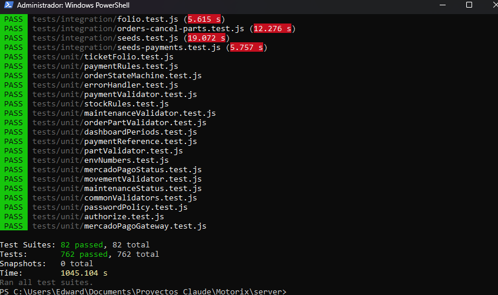

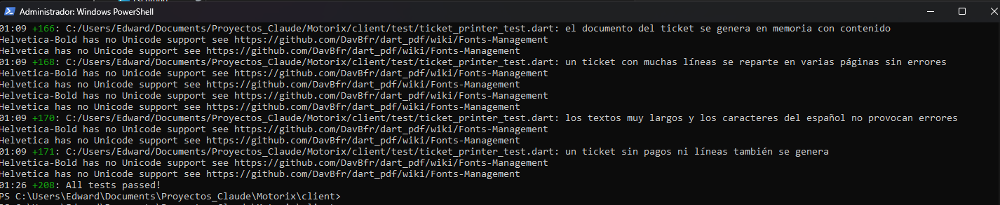

**Capturas del cierre (2026-11-03):**

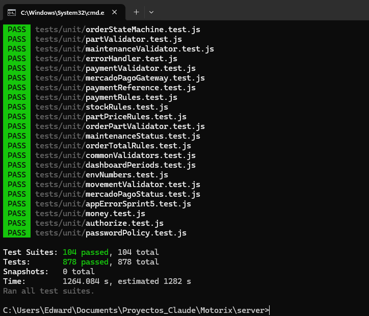

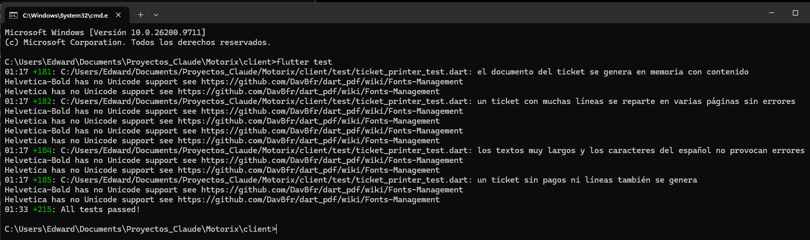

**Duración del backend:** 1045 s al inicio y 1264 s al cierre (el sprint agregó 22 suites y 116 pruebas de integración).

**Fecha del cierre:** 2026-11-03, sobre la rama `005-precios-refacciones-cobro`. Ninguna prueba de la línea base pasó de verde a rojo sin un cambio declarado: se ajustaron las aserciones de 13 casos (12 del backend y 1 del cliente) por los contratos que el sprint declaró cambiar, con la misma intención y sin borrar ninguno (hallazgo H-10). `flutter analyze lib` no reporta problemas. La captura del backend muestra 104 suites y 878 pruebas porque incluye la prueba de regresión del panel, escrita después de la ejecución completa anterior (103 suites y 874 pruebas).

## 9. Control de calidad final

Cinco requisitos funcionales del Sprint 5, elegidos entre los que más pueden fallar (instantánea de precio, orden ya cobrada, ticket que conserva lo emitido, pago desfasado y permisos por rol), con el mismo formato de la matriz de calidad del MVP.

| ID | Requisito | Criterio de Aceptación | Prueba ejecutada | Resultado | Evidencia / defecto |
|:--:|---|---|---|---|---|
| RF-01 | Spec 005, FR-006: al agregar una refacción a una orden, la línea guarda el precio de venta vigente y los cambios posteriores del precio no la modifican; si el precio cambia al mismo tiempo, la línea toma el anterior o el nuevo, nunca otro valor. | Subir el precio de $180 a $250 no cambia la línea, su importe ni el total; una orden nueva toma $250; con el alta y el cambio de precio simultáneos (8 repeticiones) la línea queda en el precio anterior o en el nuevo. | Backend (Jest + supertest): `orderParts.prices.test.js` y `orderParts.prices.concurrency.test.js`, 4 casos; recorrido con la API real (escenario 1). | Aprobado | [Requisito](#e-01-requisito) · [Prueba](#e-01-prueba) · [Resultado](#e-01-resultado). Sin defectos. No hay captura de la interfaz porque la pantalla de la orden no cambia: la evidencia es la ejecución de las pruebas y del recorrido con la API. |
| RF-02 | Spec 005, FR-011: una orden con un pago Pagado no admite agregar, quitar ni cambiar la cantidad de sus refacciones. | Los tres cambios responden `409 ORDER_ALREADY_PAID` sin tocar líneas, existencias ni movimientos; con solo un pago pendiente se permiten; un mecánico nunca recibe ese código; cobrar y agregar al mismo tiempo se ejecutan una tras otra. | Backend (Jest + supertest): `payments.paidOrder.test.js`, 6 casos, y `orders-sprint5.contract.test.js`, 2 casos. | Aprobado | [Requisito](#e-02-requisito) · [Prueba](#e-02-prueba) · [Resultado](#e-02-resultado). Sin defectos. |
| RF-03 | Spec 005, FR-015: el ticket nuevo guarda al emitirse sus conceptos e importes y los muestra siempre como se emitieron; los pagos se muestran vigentes; los tickets anteriores se siguen mostrando. | Cambiar precios y líneas después de emitir no cambia lo que muestra el ticket, que avisa que la orden se modificó; un ticket anterior (contenido nulo) se consulta y se genera de nuevo sin errores y sin congelarse. | Backend (Jest + supertest): `tickets.v2.test.js` (9 casos), `emitted.compat.test.js` (3) y `tickets-sprint5.contract.test.js` (2). | Aprobado | [Requisito](#e-03-requisito) · [Prueba](#e-03-prueba) · [Resultado](#e-03-resultado). Sin defectos. Cambia una decisión del Sprint 4 (hallazgo H-10). |
| RF-04 | Spec 005, FR-014: un pago de Mercado Pago pendiente cuyo total de creación difiere del total vigente se marca como desfasado; si el proveedor lo aprueba después, queda Pagado por su importe original. | Aviso de desfase en la orden; un pago parcial sin cambio del total no se marca; cancelarlo permite cobrar el total vigente; la aprobación tardía no crea otro pago ni cambia el importe. | Backend (Jest + supertest) con pasarela simulada: `payments.outdated.test.js` (9) y `payments-sprint5.contract.test.js` (3); Flutter: `payment_outdated_test.dart` (4). | Aprobado con observación | [Requisito](#e-04-requisito) · [Prueba](#e-04-prueba) · [Resultado](#e-04-resultado). Observación: la aprobación tardía solo se probó con la pasarela simulada, porque no hay credenciales de pruebas de Mercado Pago. |
| RF-05 | Spec 005, FR-018 y FR-019: el precio de compra solo llega a la administración y el mecánico conserva lo que ve hoy, sin precio de compra ni pagos. | Recorrido de 16 rutas de consulta con cada rol buscando la clave y el valor del precio de compra: recepción y mecánico no lo reciben; el mecánico recibe precio de venta, importes y total, y ningún dato de pago. | Backend (Jest + supertest): `prices.leak.test.js` (3) y `orders.mechanicView.test.js` (4), más una verificación de eficacia (3 y 2 fallas al forzar una fuga). | Aprobado | [Requisito](#e-05-requisito) · [Prueba](#e-05-prueba) · [Resultado](#e-05-resultado). Sin defectos. |

## 10. Cierre

| Campo | Valor |
|---|---|
| Criterios de salida cumplidos | 5 de 5: los 14 criterios de aceptación (12 aprobados y 2 con observación), la regresión de los sprints 1 a 4 sin pruebas rotas salvo 13 casos ajustados por contratos declarados, sin defectos críticos ni altos, la matriz con sus evidencias y sin contradicciones entre el reporte, el análisis y la matriz |
| Defectos abiertos | Ninguno crítico, alto ni medio. Riesgo abierto de gobernanza: R-14, la ratificación de la enmienda 1.1.0 de la constitución por el director del proyecto (baja). Aceptado: H-17 (las primeras consultas del panel tras una carga masiva, sin estadísticas de MySQL al día, tardan de 4 a 8 s; con las estadísticas al día tardan unos 200 ms) |
| Observaciones | Tiempos medidos con la interfaz por el responsable, con cronómetro (SC-004): cobrar la orden OS-2026-0009 y abrir su ticket, **15.84 s** (meta: menos de 2 minutos, cumplida); generar el ticket de OS-2026-0008 sin cobrar, 8.05 s; abrir un ticket ya existente (TK-2026-0003), 4.38 s. Límites: la aprobación tardía de un pago de Mercado Pago solo se probó con la pasarela simulada y el pago desfasado de la demostración se preparó con un pago pendiente insertado en la base, porque no hay credenciales de pruebas; RF-01 no tiene captura de interfaz; la ratificación de la enmienda (R-14) sigue por confirmarse |
| Aprobado por | Edward Negrete Bustos, responsable del sprint |
| Fecha | 2026-11-03 |

# Anexo de evidencias

Cada evidencia tiene tres bloques: **Requisito** (texto de la especificación con archivo y línea), **Prueba** (código o descripción) y **Resultado** (comando, salida real y captura). Las capturas están en `docs/evidencias/sprint-5/`.

## E-01 Requisito

Archivo: `specs/005-precios-refacciones-cobro/spec.md`, línea 186.

> **FR-006**: Al agregar una refacción a una orden, el sistema DEBE guardar en la línea el precio de venta vigente en ese momento; los cambios posteriores del precio de la refacción NO DEBEN modificar la línea. Si el precio cambia al mismo tiempo que el alta, la línea toma el precio anterior o el nuevo, nunca otro valor.

## E-01 Prueba

Archivos: `server/tests/integration/orderParts.prices.test.js`, líneas 20 a 43, y `server/tests/integration/orderParts.prices.concurrency.test.js`, líneas 10 a 32.

Se agrega una refacción de $180.00 a una orden con un servicio de $500.00 y el administrador sube después su precio de venta a $250.00. La línea (180.00), su importe (360.00) y el total (860.00) deben quedar igual, y una orden nueva debe tomar 250.00. En la prueba de concurrencia, el alta de la línea y el cambio de precio a 300.00 se envían al mismo tiempo ocho veces: la línea debe quedar con 100.00 o con 300.00, nunca con otro valor.

Fragmento de la prueba:

```js
const antes = (await detalle(tokens.admin, orden.id)).body.data;
expect(antes.parts[0]).toMatchObject({ unitPrice: 180, subtotal: 360 });
expect(antes.total).toBe(860);

const cambio = await cambiarPrecio(tokens.admin, pieza.id, 250);
expect(cambio.status).toBe(200);

const despues = (await detalle(tokens.admin, orden.id)).body.data;
expect(despues.parts[0]).toMatchObject({ unitPrice: 180, subtotal: 360 });
expect(despues.partsTotal).toBe(antes.partsTotal);
```

## E-01 Resultado

Comando: `npm test -- tests/integration/orderParts.prices.test.js tests/integration/orderParts.prices.concurrency.test.js`

Pasaron las 4 pruebas de las 2 suites. En el recorrido contra la API real (E-06), el escenario 1 mostró la línea en $150.00 tras subir el precio a $175.00, con el total sin cambios, y la orden nueva con $175.00.

Resultado: **Aprobado** (4 de 4 casos). Sin captura de la interfaz: la pantalla no cambia y el comportamiento se demuestra con la prueba y el recorrido por la API.

## E-02 Requisito

Archivo: `specs/005-precios-refacciones-cobro/spec.md`, línea 194.

> **FR-011**: El sistema NO DEBE permitir agregar, quitar ni cambiar la cantidad de las refacciones de una orden que tiene un pago Pagado, y DEBE indicar que la orden ya está cobrada, sin modificar líneas, existencias ni movimientos de inventario. Con solo pagos Pendientes sí se permite, y el pago queda desfasado según FR-014. Esta regla sustituye a la del Sprint 4, que permitía a la administración cambiar las refacciones de una orden terminada ya cobrada con un motivo.

## E-02 Prueba

Archivo: `server/tests/integration/payments.paidOrder.test.js`, líneas 32 a 52, y el bloque de concurrencia al final del archivo.

Con una orden terminada y cobrada por completo ($1,200.00), la administración intenta agregar otra refacción, sumar a la misma, cambiar la cantidad y quitar la línea. Los cuatro cambios responden `409 ORDER_ALREADY_PAID` con el mensaje «La orden ya está cobrada: no se pueden modificar las refacciones.» y no cambian líneas, existencias ni movimientos. Con solo un pago pendiente de Mercado Pago sí se permiten, un mecánico recibe antes un 403 o el 409 de estado final y nunca ese código, y si la administración cancela el pago cobrado la orden vuelve a admitir cambios. En la prueba de concurrencia se cobra y se agrega una refacción al mismo tiempo, ocho veces: las dos operaciones se ejecutan una tras otra y la segunda se evalúa con el resultado de la primera.

Fragmento de la prueba:

```js
const respuestas = [
  await agregar(tokens.admin, orden.id, { partId: otra.id, quantity: 1, reason: MOTIVO }),
  await agregar(tokens.admin, orden.id, { partId: pieza.id, quantity: 1, reason: MOTIVO }),
  await cambiar(tokens.admin, orden.id, linea.id, { quantity: 3, reason: MOTIVO }),
  await quitar(tokens.admin, orden.id, linea.id, { reason: MOTIVO })
];
for (const res of respuestas) {
  expect(res.status).toBe(409);
  expect(res.body.error.code).toBe('ORDER_ALREADY_PAID');
  expect(res.body.error.message).toBe('La orden ya está cobrada: no se pueden modificar las refacciones.');
}
```

## E-02 Resultado

Comando: `npm test -- tests/integration/payments.paidOrder.test.js tests/contract/orders-sprint5.contract.test.js`

Pasaron las 8 pruebas de las 2 suites. En el recorrido contra la API real (E-06), los escenarios 5 y 6 confirmaron los tres 409 con OS-2026-0009 y el resultado de cobrar y agregar a la vez con OS-2026-0010. En la interfaz, la administración recibe el aviso al intentar agregar una refacción a una orden ya pagada:

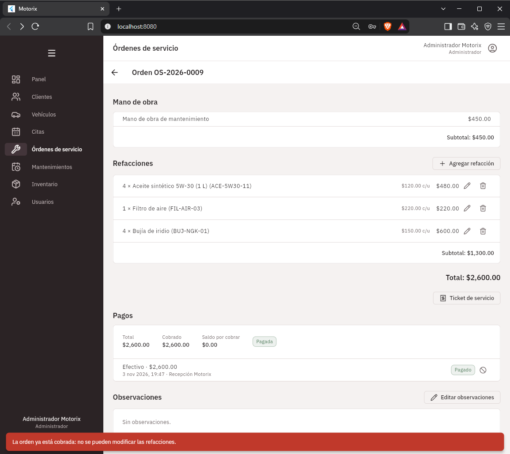

Resultado: **Aprobado** (8 de 8 casos).

## E-03 Requisito

Archivo: `specs/005-precios-refacciones-cobro/spec.md`, línea 201.

> **FR-015**: El ticket nuevo DEBE guardar al emitirse los datos del taller (nombre, dirección y teléfono), del cliente (nombre y teléfono), del vehículo (descripción, placa y kilometraje), el folio de la orden, las líneas (servicios, mano de obra y refacciones con descripción, cantidad, precio unitario e importe), los subtotales y el total, y mostrarlos siempre tal como se emitieron. Los pagos y su estado de pago NO se guardan en el ticket: se muestran vigentes al consultarlo. Si el total vigente de la orden difiere del total guardado en el ticket, el ticket DEBE indicar «La orden se modificó después de generar este ticket» (aviso del Sprint 4), sin cambiar lo que muestra ni impedir los cambios de la orden. Los tickets anteriores al sprint NO se congelan al migrar: se siguen armando con los datos vigentes como hasta ahora (FR-016). Este requisito reemplaza lo que decía el FR-021 del Sprint 4 («no guardar copia del contenido») solo para los tickets nuevos.

## E-03 Prueba

Archivos: `server/tests/integration/tickets.v2.test.js`, líneas 57 a 72, `server/tests/integration/emitted.compat.test.js` y `server/tests/contract/tickets-sprint5.contract.test.js`.

Se emite el ticket de una orden con servicio, mano de obra y refacciones (total $1,400.00), y después se cambian el precio de las refacciones y las líneas de la orden. El ticket debe seguir mostrando los servicios, la mano de obra, las refacciones, los subtotales y el total emitidos, y avisar que la orden cambió; los pagos se muestran vigentes. Un ticket anterior al sprint (contenido nulo) se consulta y se genera de nuevo con su mismo folio sin errores y sin quedar congelado, y los tickets sembrados antes conservan su contenido en nulo.

Fragmento de la prueba:

```js
const { orden, tokens } = await ordenConLineas();
const emitido = (await generar(tokens.recepcion, orden.id)).body.data;
expect(emitido.orderChangedSinceGenerated).toBe(false);

await pool.query('UPDATE order_parts SET unit_price = 999 WHERE order_id = ?', [orden.id]);
await addServiceLine(orden.id, 'Extra posterior', 200, 'order_labor');

const consulta = (await consultar(tokens.recepcion, orden.id)).body.data;
expect(consulta.services).toEqual(emitido.services);
expect(consulta.labor).toEqual(emitido.labor);
expect(consulta.parts).toEqual(emitido.parts);
expect(consulta.subtotals).toEqual(emitido.subtotals);
```

## E-03 Resultado

Comando: `npm test -- tests/integration/tickets.v2.test.js tests/integration/emitted.compat.test.js tests/contract/tickets-sprint5.contract.test.js`

Pasaron las 14 pruebas de las 3 suites, y las 11 de `tickets.test.js` (con una aserción ajustada, H-10). En el recorrido contra la API real (E-06), el escenario 7 mostró TK-2026-0003 con $3,490.00 y sus dos refacciones tras subir un precio y agregar una refacción, con el aviso de orden modificada, y el escenario 8 consultó y regeneró TK-2026-0001 sin congelarlo. En la interfaz:

Ticket nuevo (TK-2026-0003, con su contenido guardado):

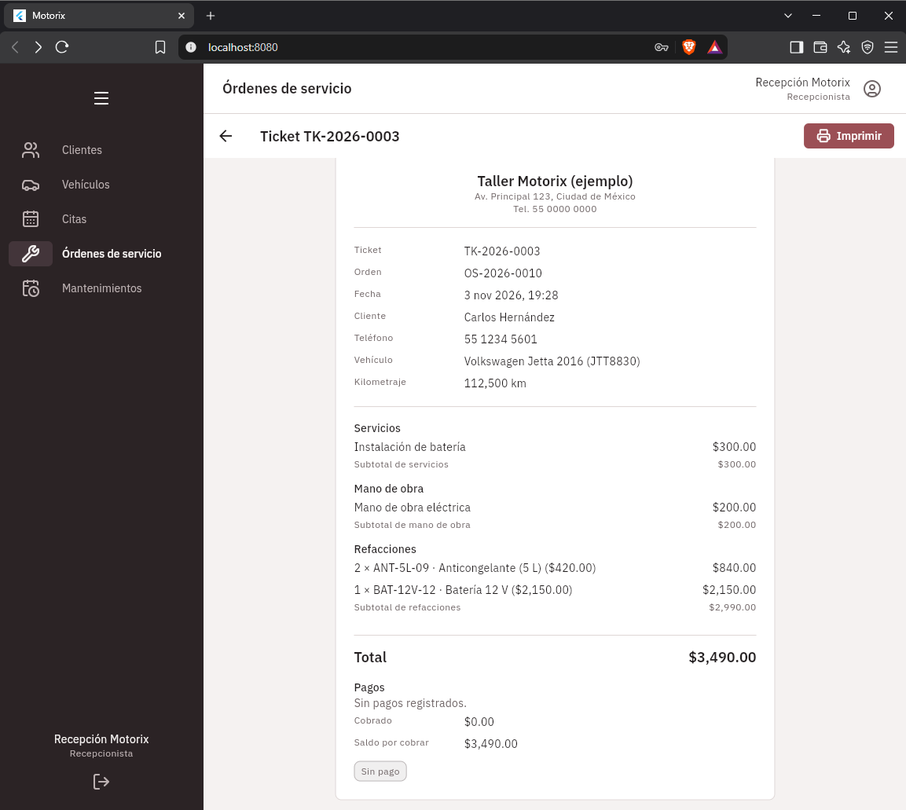

Ticket anterior al sprint (TK-2026-0001):

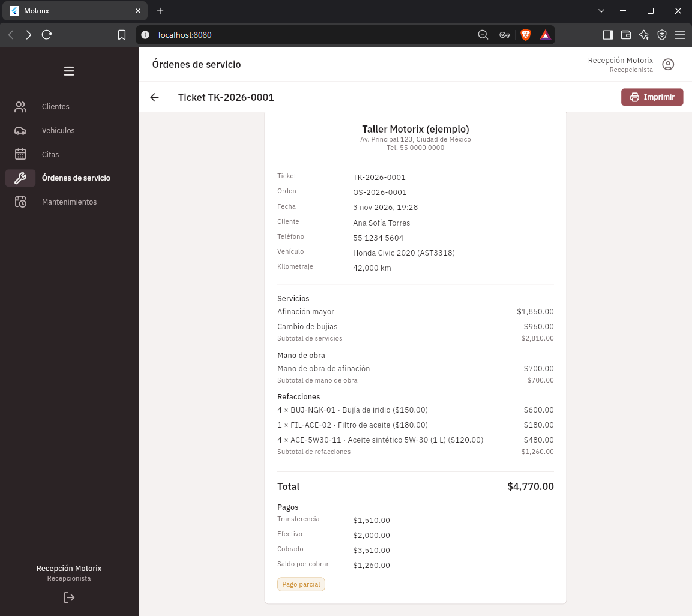

Ticket de una orden cobrada (TK-2026-0004), con el pago vigente en el comprobante:

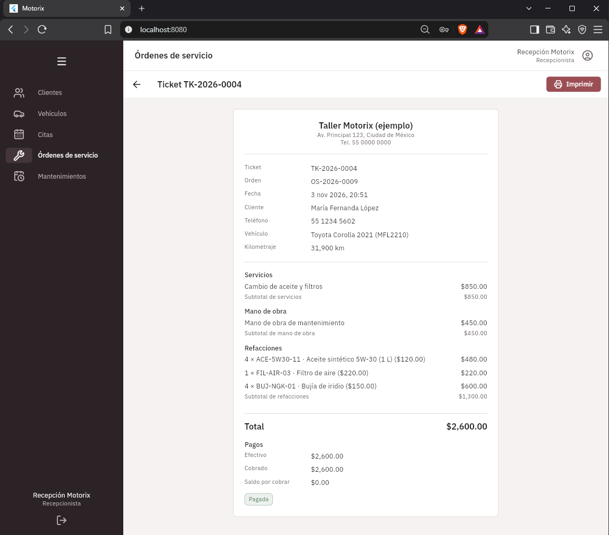

Resultado: **Aprobado** (14 de 14 casos).

## E-04 Requisito

Archivo: `specs/005-precios-refacciones-cobro/spec.md`, línea 197.

> **FR-014**: Un pago de Mercado Pago pendiente DEBE marcarse como desfasado cuando el total vigente de la orden es distinto del total que tenía la orden al crearse el pago; por eso todo pago nuevo DEBE guardar el total de la orden con el que se creó. El desfase se determina al consultar la orden o el pago (se calcula en la consulta; solo se guarda el total de creación) y se muestra con un aviso visible en la orden. Los pagos creados antes del sprint no tienen ese dato y no se marcan como desfasados; un pago parcial pendiente no está desfasado mientras el total no cambie. El sistema NO DEBE cambiar su importe ni cancelarlo por su cuenta: para cobrar el total vigente, el pago desfasado debe cancelarse antes, y lo cancelan recepción o la administración con motivo obligatorio, como cualquier pago pendiente del Sprint 4. Si el proveedor lo aprueba después, el pago DEBE registrarse como Pagado por su importe original, la orden DEBE mostrar la diferencia entre el total y lo cobrado, y el sistema NO DEBE crear ni cobrar automáticamente la diferencia ni un pago nuevo; esa diferencia se resuelve fuera del sistema. Si el servicio de Mercado Pago no responde al consultar un pago desfasado, se aplica lo del Sprint 4: mensaje claro y el pago no cambia.

## E-04 Prueba

Archivo: `server/tests/integration/payments.outdated.test.js`, líneas 56 a 68, y `client/test/payment_outdated_test.dart`.

Con la pasarela simulada, un pago de Mercado Pago pendiente por $1,250.00 se crea con el total de la orden en $1,250.00; la administración agrega después una refacción de $100.00 y el total pasa a $1,350.00. El pago aparece con `outdated: true` en el listado de pagos y el resumen de la orden con `hasOutdatedPending: true`. Un pago parcial pendiente con el total sin cambios no se marca, un pago anterior al sprint (total de creación nulo) tampoco, y el sistema no cambia ni cancela el pago por su cuenta. Cancelarlo (recepción, con motivo) permite cobrar el total vigente. Si el proveedor lo aprueba después, queda Pagado por $1,250.00, el saldo muestra $100.00 de diferencia y no se crea otro pago; si Mercado Pago no responde, el pago no cambia (503).

Fragmento de la prueba:

```js
const { orden, tokens } = await ordenConPagoDesfasado();

const pagos = await listarPagos(tokens.recepcion, orden.id);
expect(pagos.body.data.payments).toHaveLength(1);
expect(pagos.body.data.payments[0]).toMatchObject({ status: 'PENDIENTE', amount: 1250, totalAtCreation: 1250, outdated: true });
expect(pagos.body.data.summary).toMatchObject({ total: 1350, hasOutdatedPending: true });

```

## E-04 Resultado

Comando: `npm test -- tests/integration/payments.outdated.test.js tests/contract/payments-sprint5.contract.test.js` y `flutter test test/payment_outdated_test.dart`

Pasaron las 12 pruebas del backend (2 suites) y las 4 del cliente. En el recorrido contra la API real (E-06), el escenario 9 mostró el pago de $1,240.00 pasando a `outdated: true` al subir el total a $1,460.00; el pago pendiente se insertó directo en la base porque no hay credenciales de Mercado Pago. En la interfaz (OS-2026-0011, sesión de recepción), el aviso ámbar y la insignia «Desfasado» se ven en la primera pantalla de la orden:

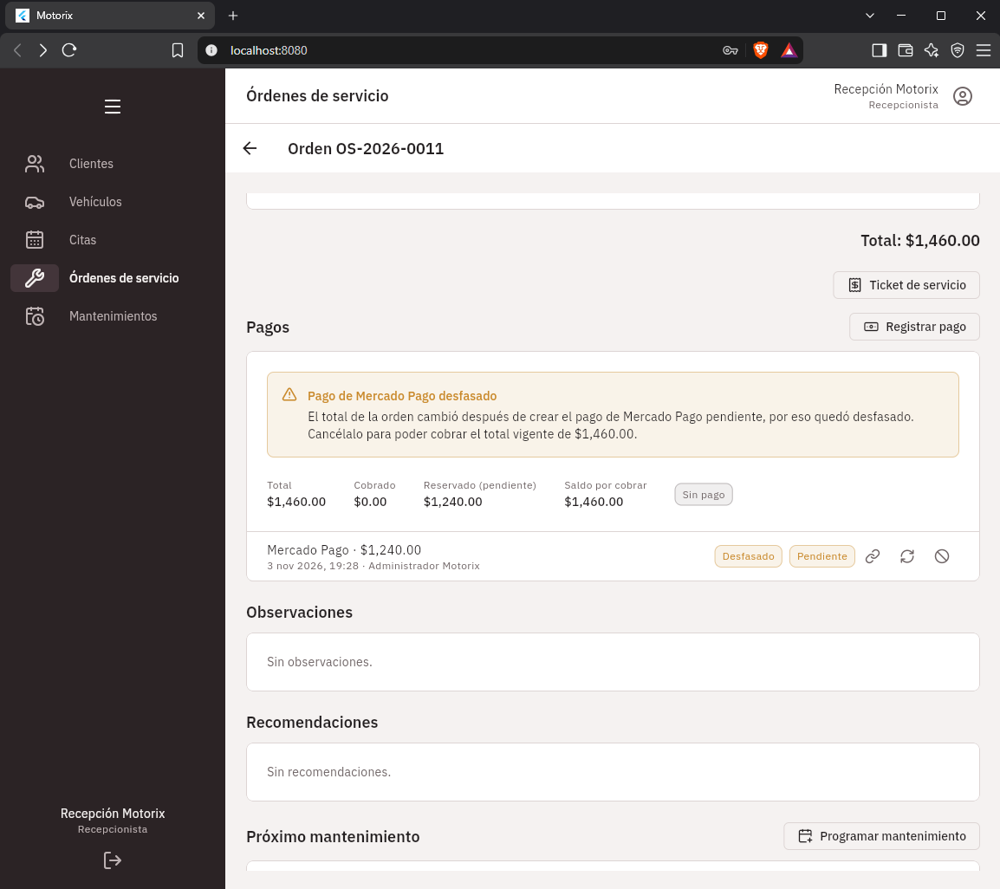

Resultado: **Aprobado con observación** (16 de 16 casos). Observación: la aprobación tardía solo se probó con la pasarela simulada.

## E-05 Requisito

Archivo: `specs/005-precios-refacciones-cobro/spec.md`, línea 207.

> **FR-018**: El precio de compra DEBE ser visible solo para la administración; el sistema NO DEBE entregarlo a recepción ni al mecánico en ninguna consulta (inventario, alertas de stock, movimientos, historial del vehículo, panel de control, órdenes, pagos y tickets).

Archivo: `specs/005-precios-refacciones-cobro/spec.md`, línea 208.

> **FR-019**: El mecánico DEBE seguir pudiendo agregar refacciones a una orden y consultar el inventario de las refacciones activas. Conserva lo que ve hoy: el precio de venta, el importe de cada línea y el total de la orden; NO DEBE recibir nunca el precio de compra, los pagos ni el estado de pago. El recorrido de permisos fija con pruebas qué recibe en cada ruta.

## E-05 Prueba

Archivos: `server/tests/integration/prices.leak.test.js`, líneas 61 a 89, y `server/tests/integration/orders.mechanicView.test.js`.

Con una refacción de precio de compra 73.41 y de venta 188.88 en una orden terminada con pago y ticket, la prueba recorre 16 rutas de consulta con administración, recepción y mecánico (inventario, búsqueda, detalle, categorías, alertas, movimientos, órdenes, pagos, ticket, historial y vehículo, mantenimientos y panel) y busca en cada respuesta la clave `purchase` y el valor 73.41. Recepción y mecánico no lo reciben en ninguna ruta; la administración responde 200 en todas (así se sabe que ninguna ruta está mal escrita) y recibe el precio de compra. El mecánico recibe el precio de venta, el importe de las líneas y el total, y ningún dato de pago, y las rutas de pagos y tickets le responden 403.

Fragmento de la prueba:

```js
for (const r of respuestas.filter((item) => item.rol === 'administración')) {
  expect({ ruta: r.nombre, status: r.status }).toEqual({ ruta: r.nombre, status: 200 });
}

const filtraciones = respuestas
  .filter((item) => item.rol !== 'administración' && contieneElPrecioDeCompra(item.texto))
  .map((item) => `${item.rol} · ${item.nombre}`);
expect(filtraciones).toEqual([]);
```

## E-05 Resultado

Comando: `npm test -- tests/integration/prices.leak.test.js tests/integration/orders.mechanicView.test.js`

Pasaron las 7 pruebas de las 2 suites. Verificación de eficacia: al forzar que el mecánico recibiera el precio de compra fallaron 3 pruebas, y al forzar que recibiera datos de pago fallaron 2 (hallazgo H-16); el código se restauró. En el recorrido contra la API real (E-06), el escenario 13 recorrió 14 rutas con los 3 roles sin ninguna fuga. En la interfaz, la sesión del mecánico ve el precio de venta y el importe de sus refacciones, no tiene sección de Pagos y su menú no ofrece Inventario:

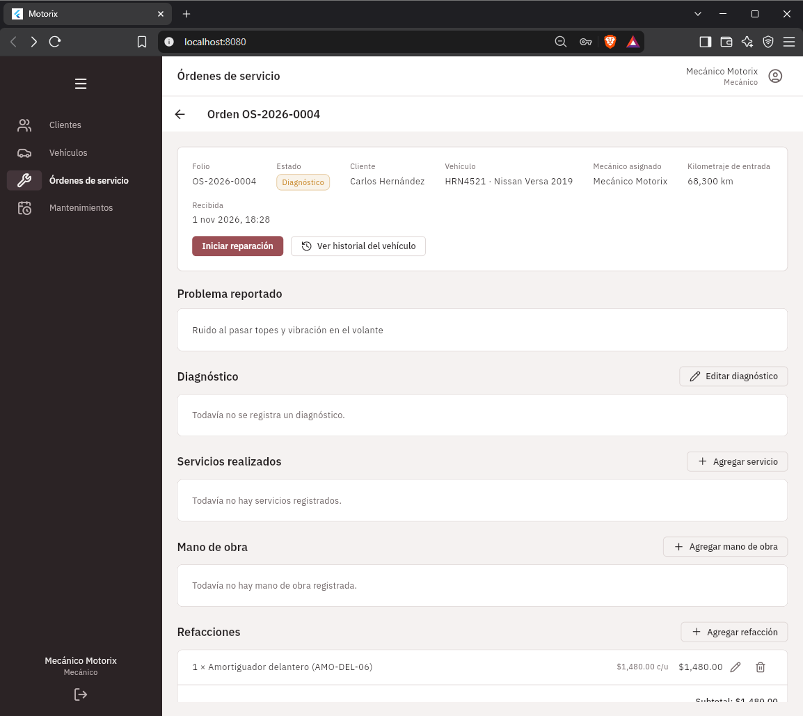

Resultado: **Aprobado** (7 de 7 casos).

## E-06 Recorrido de los escenarios contra la API real

Fecha: 2026-11-03. Se levantó la API real (`app.js` de Express en un puerto libre) sobre MySQL 8.4.9 real, con la base `motorix_test` vaciada y sembrada con los seeds 001 a 010 y las cuentas de ejemplo `admin`, `recepcion` y `mecanico`. Un guion por HTTP ejecutó los 15 escenarios de `specs/005-precios-refacciones-cobro/quickstart.md`. Mercado Pago no tiene credenciales en este entorno, así que no se pudo cobrar con la pasarela real.

| # | Escenario | Resultado |
|---|-----------|-----------|
| 1 | Instantánea del precio | Línea de $150 en OS-2026-0004; tras subir el precio a $175 la línea y el total no cambian; una orden nueva toma $175 |
| 2 | Total en centavos | 3 × 33.33 = $99.99 exacto; el total de la API ($274.99) coincide con la suma de las líneas en la base |
| 3 | Orden con solo refacciones | OS-2026-0011 (solo refacciones, total $440): se cobra por su total y queda PAGADA |
| 4 | Límite del total | Un servicio llevó el total a $99,999,999.99; $0.01 más de mano de obra y una refacción más respondieron 422 `ORDER_TOTAL_LIMIT_EXCEEDED` |
| 5 | Orden ya cobrada | OS-2026-0009 cobrada por $2,600: agregar, cambiar la cantidad y quitar respondieron 409 `ORDER_ALREADY_PAID`; stock y movimientos sin cambios |
| 6 | Cobrar y agregar a la vez | Con la orden OS-2026-0010: el cobro entró primero y el alta respondió 409 `ORDER_ALREADY_PAID`; el resumen quedó PAGADA por $4,740 |
| 7 | Ticket que conserva lo emitido | TK-2026-0003: tras subir un precio y agregar una refacción siguió mostrando $3,490 y sus refacciones emitidas, con el aviso de orden modificada |
| 8 | Ticket anterior | TK-2026-0001: se consultó (200) y se generó de nuevo (200) con el mismo folio; su contenido sigue en NULL (no se congeló) |
| 9 | Pago desfasado | OS-2026-0012: pago pendiente de $1,240 creado con total $1,240; al subir el total a $1,460 quedó `outdated: true` y `hasOutdatedPending: true`; el mecánico no recibe datos de pago. El pago pendiente se insertó directo en la base por no haber credenciales |
| 10 | Aprobación tardía | **No ejecutable contra la API real** (exige credenciales de pruebas de Mercado Pago); cubierta con la pasarela simulada en `payments.outdated.test.js` |
| 11 | Precio bajo el costo | Sin confirmar: 422 `PRICE_BELOW_COST` y no guarda; confirmada: 201 |
| 12 | Precio cero | 0/0: 201; compra $50 y venta $0: 422 sin confirmar y 201 confirmada; la línea en una orden vale $0 |
| 13 | Permisos de precios | 14 rutas con 3 roles: ninguna fuga del precio de compra; administración 14 respuestas 200, recepción 7 y mecánico 9 (las demás son 403 por rol) |
| 14 | Panel y listados | Panel 200 en 21 ms; los 4 saldos pendientes coinciden con el detalle de su orden; el listado trae el total de todas |
| 15 | Seeds | Cargados dos veces sobre los datos del recorrido: los conteos no cambian; OS-2026-0009 existe una vez y TK-2026-0003 trae su contenido |

Resultado: **Aprobado** (14 de 14 escenarios ejecutables; el 10 se comprueba solo con pruebas automatizadas). El primer intento falló en 2 escenarios (el 4 y el 13) por errores del propio guion (un token sin permiso sobre esa orden y un ticket aún no generado), no del sistema; se corrigió el guion y se repitió el recorrido completo desde una base limpia.

Alcance: esta comprobación cubre la API y los datos. Las pantallas de Flutter se comprobaron con las pruebas del cliente (215 pruebas aprobadas) y con el recorrido manual del responsable en la aplicación (`http://localhost:8080`, API sobre `motorix_test`), cuyas capturas están en los bloques E-02 a E-05 y a continuación.

**Evidencias de la interfaz que no pertenecen a un solo requisito:**

Al guardar una refacción con precio de compra $100 y de venta $80, el servidor exige la confirmación y la pantalla muestra el cuadro (FR-003):

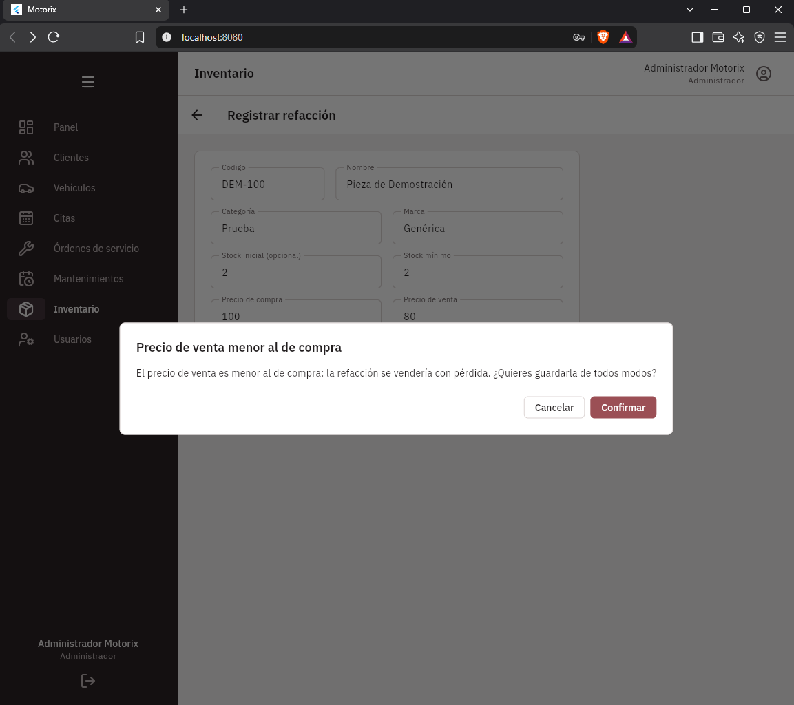

**Tiempos con la interfaz (SC-004), medidos con cronómetro por el responsable, sesión de recepción.** Cobrar la orden terminada OS-2026-0009 por $2,600.00 en efectivo y abrir su ticket, desde que se abre el detalle de la orden hasta que se ve el ticket: **15.84 s** (meta: menos de 2 minutos, cumplida). Para comparar, generar el ticket de OS-2026-0008 sin cobrar tomó **8.05 s** y abrir un ticket ya existente (TK-2026-0003), **4.38 s**.

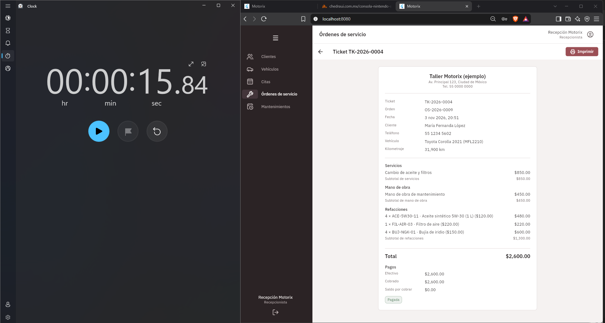

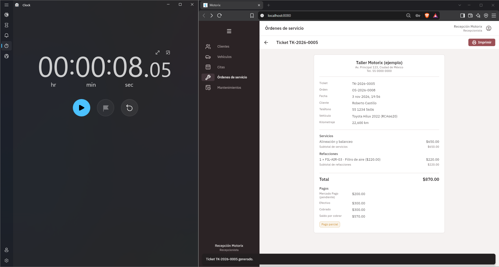

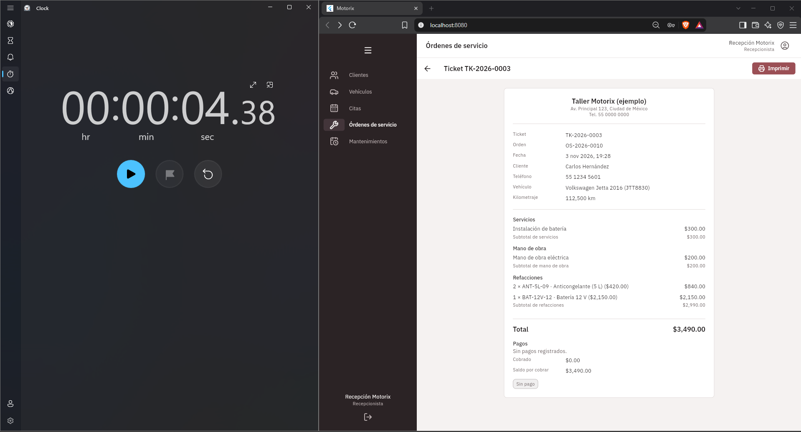
